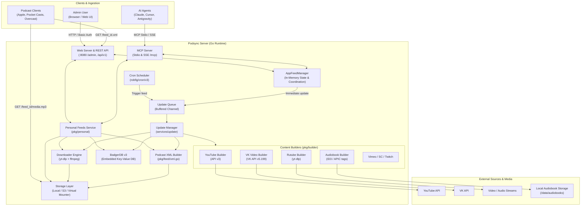
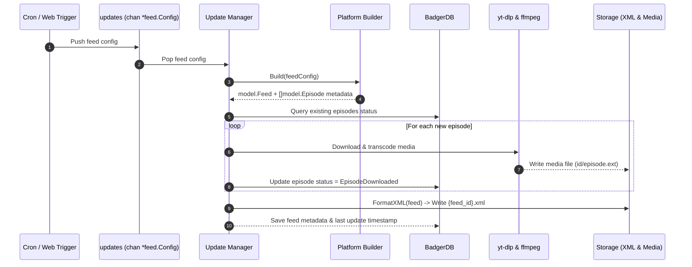

# Architecture & System Design

This document details the architectural principles, component structure, data flow, concurrency patterns, and storage mechanisms of **Podsync**.

---

## 1. High-Level Architecture

Podsync operates as a self-hosted content pipeline that transforms external video and audio sources (YouTube, Rutube, VK Video, Vimeo, SoundCloud, Twitch) as well as local directory audiobook collections into podcast feeds compatible with Apple Podcasts, Pocket Casts, Overcast, AntennaPod, and any RSS reader.

---

## 2. Core Components

### 2.1 AppFeedManager (`cmd/podsync/feed_manager.go`)
The central orchestrator connecting the Web UI, MCP protocol, BadgerDB, and the Update pipeline:
- Holds in-memory thread-safe references to all registered feed configs (`m.feeds map[string]*feed.Config`).
- Manages dynamic additions, updates, deletions, and config persistence to `config.toml`.
- Coordinates live reload: on any feed configuration update (`UpdateFeed`), it triggers `m.updates <- f` so the RSS XML is immediately regenerated.
- Implements `web.AdminManager` interface consumed by both REST API and MCP proxy.

### 2.2 Content Builders (`pkg/builder/`)
Platform-specific metadata parsers implementing the `builder.Builder` interface:
- **`youtube.go`**: Queries YouTube Data API v3 for channel/playlist uploads, tracks episode IDs, titles, descriptions, and durations.
- **`vkvideo.go`**: Interfaces with VK API v`5.199`, converts community handles (`@name`) to negative owner IDs (`-196446247`), excludes live streams/premieres, and formats playable links.
- **`rutube.go`**: Queries Rutube video lists via native `yt-dlp` scraping without requiring third-party API tokens.
- **`audiobook.go`**: Local directory crawler. Automatically scans MP3/M4A/FLAC/OGG files, sorts chapters naturally, extracts album/artist/title ID3 tags, and extracts embedded APIC cover art via `ffmpeg`.

### 2.3 Downloader Engine (`pkg/ytdl/`)
- Encapsulates `yt-dlp` process execution with configurable timeout, proxy, and audio transcoding.
- Injects Netscape `cookies.txt` or `--cookies-from-browser` to bypass YouTube bot detection and 429 rate limits.
- Supports custom format selection (`bestaudio`, `bestvideo[height<=?]+bestaudio/best`).

### 2.4 Podcast XML Generator (`pkg/feed/xml.go`)
- Builds standard iTunes Podcast XML feeds and Podcast 2.0 specifications.
- **Serial Feeds**: Emits `<itunes:type>serial</itunes:type>` and `<itunes:episode>N</itunes:episode>` for audiobooks so chapters play in sequential order.
- **Private Feeds**: Checks `feed.PrivateFeed || cfg.PrivateFeed`. When true, renders `<itunes:block>yes</itunes:block>` to prevent podcast directories (Apple Podcasts Directory, Spotify, Podcast Index) from publicly indexing the feed.

### 2.5 Storage Layer & Virtual Mounter (`pkg/fs/`)
- Standard storage abstraction (`fs.Storage`) supporting local disk and AWS S3.
- **Virtual Mounter (`fs.Mounter`)**: For local audiobook feeds (`audiobook://`), mounts the source directory directly under the feed namespace without copying multi-gigabyte audio files into Podsync's data directory.

### 2.6 Personal Feeds Service (`pkg/personal/`)
Core service orchestrating manually curated, universal podcast feeds:
- **Universal Format (Audio + Video)**: Supports mixing audio tracks (MP3, OGG, OPUS, WAV, FLAC) and video tracks (MP4, MKV, WebM) within the same feed, assigning dynamic `<enclosure>` MIME types per episode.
- **Reference-Counted Media Pool**: Uploaded and downloaded files live in a shared directory (`_personal/{media_id}/`). Copying an episode to another feed creates a new membership GUID without duplicating the file on disk. Files are only deleted when the reference counter reaches zero and deletion was confirmed.
- **Ingestion Pipeline**: Ingests direct media URLs, platform links (YouTube, VK Video, Rutube), local server file paths (`file_path`), and multipart file uploads (up to 4 GiB) with automatic `ffmpeg` transcoding.
- **State Isolation**: Operates inside an independent BadgerDB transactional namespace (`podsync/personal/v1/`), preventing collisions with `config.toml` channels.

---

## 3. Data Flow & Concurrency

### 3.1 Feed Synchronization Sequence

### 3.2 Concurrency Safeguards
- **Channel Buffer**: `updates` channel has a buffer capacity (16 slots). If a burst of updates arrives, excess requests are rejected with a 503/warning without blocking the server.
- **Thread-Safe Maps**: `AppFeedManager` guards `feeds`, `cronEntries`, and `tokens` with a `sync.RWMutex`.
- **Database Concurrency**: BadgerDB handles concurrent readers and atomic write batches.

---

## 4. Database Schema (BadgerDB v3)

Podsync uses embedded BadgerDB keys with structured binary/JSON prefixes:
- `feed:{feed_id}`: Serialized `model.Feed` (metadata, title, description, author, cover URL, provider).
- `episode:{feed_id}:{episode_id}`: Serialized `model.Episode` (status, size, duration, file path, download timestamp, error state).
- `state:{key}`: Server state variables, tokens, and pagination cursors.

Status values:
- `EpisodeNew` (0): Discovered but not yet downloaded.
- `EpisodeDownloaded` (1): Stored on disk and served via RSS enclosure.
- `EpisodeError` (2): Failed to download (network, rate limit, ffmpeg error).
- `EpisodeCleaned` (3): Pruned by retention policy (`keep_last`).

### 4.1 Personal Feeds Namespace (`podsync/personal/v1/`)
Personal feeds maintain transactional records segregated from standard feeds:
- `feed/{feed_id}`: Serialized `personal.Feed` (title, description, cover art URL, sort order, private flag, episode count).
- `episode/{feed_id}/{episode_id}`: Serialized `personal.Membership` (episode GUID, pointer to shared `media_id`, added timestamp).
- `media/{media_id}`: Serialized `personal.Media` (source URL/path, stored path, format, duration, size, status, error, reference count).
- `initialized`: Flag marking initial database seeding (`My Feed` / `personal`).
- `deleted/{feed_id}` / `delete_pending`: Tombstones for async background cleanup.
