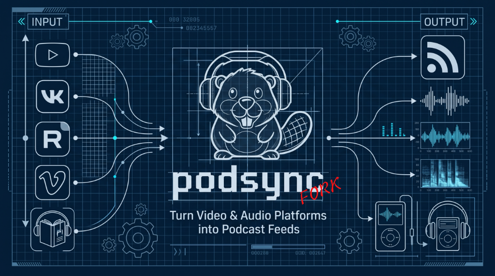

# Podsync

<p align="center">
  
</p>

<p align="center">
  <b>English</b> | <a href="README_RU.md">Русский</a>
</p>

[](https://github.com/tatarinovms/podsync/releases/latest)
[](https://github.com/tatarinovms/podsync/pkgs/container/podsync)
[](go.mod)
[](LICENSE)

[Key Features](#key-features) • [Firefox Extension](#firefox-extension) • [Quick Start](#quick-start) • [Configuration](#configuration) • [Web Admin & API](#web-admin-console--rest-api) • [MCP Server](#model-context-protocol-mcp-server) • [Documentation](#documentation)

Podsync is a lightweight podcast generator that turns video, audio, local audiobook folders, and existing podcast RSS feeds into standards-compliant podcast feeds. Podcast apps download new episodes in the background, remember listening positions, synchronize devices, and support offline playback.

This fork extends the original `mxpv/podsync` with the features described below.

## Key Features

### 1. Multi-Platform Sources & RSS Mirroring

- Create standard podcast RSS feeds from **YouTube, Rutube, VK Video, Vimeo, SoundCloud**, Apple Podcasts show pages, local audiobooks, and third-party Podcast RSS feeds. Rutube supports channels, playlists, user profiles, and individual videos without API keys; VK Video supports `vkvideo.ru`, `vk.com`, and `vk.ru` channels, communities, users, and playlists.
- Mirror any `http://`, `https://`, or `*.xml` podcast RSS feed with a live metadata preview (artwork, episode count, and size) and direct HTTP-to-disk media streaming, without intermediate `/tmp` buffering or RAM spikes.
- Choose a Download Scope of **All episodes**, **Last 10**, **Last 25**, or **Last 50**. It synchronizes with `page_size` and `keep_last` to clamp large archives before they exhaust storage.
- Configure video or audio format, quality profile, maximum video height, cron updates, custom artwork with live preview, category, language, OPML export, automatic cleanup of the last *X* episodes, API-key rotation, and post-download hooks/webhooks. Podsync runs on Windows (`x86_64`), macOS (`arm64`), Linux (`x86_64`, `arm64`), and Docker.

### 2. Personal Feeds & 1-Click Ingest

- Create curated feeds in **Library → Personal feeds**; they also appear in the main Podcasts view with the Personal filter. Add YouTube, VK Video, Rutube, direct HTTP/HTTPS media URLs, or local uploads up to **4 GiB**.
- `ffmpeg` automatically transcodes audio to MP3 and video to MP4. Choose High or Low audio quality, or video resolution (480p, 720p HD, 1080p Full HD, and more), rename an episode with immediate RSS rebuild, copy it with shared-media reference counting, move it while preserving its GUID, or safely delete it. See the [Personal Feeds Guide](./docs/personal-feeds.md).
- Use the Firefox Podsync Share extension to add the active browser tab to a selected personal feed.

### 3. Local Audiobooks (Podcast 2.0 Serial)

- Discover audiobook folders containing `.mp3`, `.m4b`, `.m4a`, `.aac`, or `.ogg`, import them in one click, or upload files directly in Web Admin.
- Generate Podcast 2.0 serial feeds with `<itunes:type>serial</itunes:type>` and `<itunes:episode>N</itunes:episode>`, natural numeric track sorting (`01`, `02`, …, `10`), and automatic metadata plus embedded ID3/APIC cover-art extraction.

### 4. Audio Mastering & Podcasting 2.0

- Encode MP3 with `ffmpeg` and normalize audio with EBU R128 using `normalize_audio = true` and `loudnorm=I=-16:TP=-1.5:LRA=11`, compatible with Apple Podcasts and Spotify.
- Parse description timecodes into Podcasting 2.0 `<podcast:chapters>` JSON and embed ID3/MP4 chapters with `--embed-chapters`.
- Filter live streams and upcoming premieres with `ignore_live = true`; also filter episodes by title regex, duration bounds, and maximum age.
- Customize media paths with `filename_template` (`{{id}}`, `{{title}}`, `{{pub_date}}`) and rename existing files with `--migrate-filenames` or `--migrate-filenames-dry-run`.

### 5. Catppuccin Web Admin Console (`/admin`)

- Manage the library through a responsive console with Mocha and Latte themes, an accessible mobile navigation drawer, list and grid views, search, sorting, retry actions, cover uploads, and accurate downloaded-episode disk metrics.
- Use the bottom-docked mini-player for codec and bitrate inspection, -15/+30 second seeking, playback-speed changes, and chapter navigation. Share a feed with QR codes, clipboard links, and Apple Podcasts, Pocket Casts, or Overcast deep links.
- Each podcast has a dedicated detail page with chapters and episodes, status badges, playback and download links, retries, and deletion in the actions menu.
- Feed IDs transliterate Cyrillic (Russian, Ukrainian, and Belarusian) and diacritics into validated Latin slugs with a live RSS URL preview. The console also provides two-second real-time log polling, log search and levels, downloadable logs, configurable brute-force protection, and SHA-256-verified native self-updates.

### 6. Anti-Blocking, Selective Proxy & Network

- Route traffic through global or per-provider `[downloader.proxies]` HTTP/SOCKS5 proxies, override the proxy per feed, and keep providers on direct connections by default. `PODSYNC_DOWNLOADER_PROXY_*` environment variables are supported.
- Manage Netscape `cookies.txt`, extract cookies from a local browser, and run a live yt-dlp URL test to diagnose bot checks and age gates. Configure `dns_servers` for provider APIs and RSS metadata while yt-dlp keeps using system DNS.
- Paste a complete VK OAuth redirect URL and Podsync extracts the access token automatically.
- Export a full system `.tar.gz` backup of configuration, a consistent Badger snapshot, and custom covers, then inspect and restore it from Web Admin, CLI, or MCP. Downloaded media is excluded.

## Firefox Extension

[Download the signed Podsync Share extension (`.xpi`)](https://github.com/tatarinovms/podsync/releases/download/v2.26.6/924c9395d5e947a39fac-1.0.4.xpi), open the downloaded file in Firefox, and approve the installation.

Open **Podsync Share → Connection settings** and enter:

- **Podsync API URL**: the public Podsync address followed by `/api/v1`, for example `https://rssreader.example.com/api/v1`.
- **Admin username** and **Admin password**: the same credentials used to sign in to Web Admin.

Select **Save and load feeds**, choose a Personal Feed, then open a YouTube, VK Video, or Rutube page. Select **Add current tab**, choose MP3 audio or MP4 video and its quality, and confirm. The extension closes after Podsync accepts the link.

## Quick Start

### Prebuilt Binary (Recommended)

1. Open the [latest Podsync release on GitHub](https://github.com/tatarinovms/podsync/releases/latest) and download the archive matching your OS and CPU: `Linux_x86_64`, `Linux_arm64`, `Darwin_arm64` (Apple Silicon macOS), or `Windows_x86_64`. Choose `.tar.gz` for Linux/macOS or `.zip` for Windows.
2. Extract it into its own directory. Copy the [sample configuration](./config.toml.example) to `config.toml` beside the executable, then set your paths, server address, and feeds.
3. Install `yt-dlp` and `ffmpeg` (see [Dependencies](#dependencies)), then run Podsync from that directory:

```bash
./podsync --config config.toml
```

On Windows, run `./podsync.exe --config config.toml` in PowerShell. This method does not require the source code or Go. For detailed Linux installation commands, see the [Deployment & Setup Guide](./docs/deployment_guide_agents.md).

### Docker Compose

```yaml
services:
  podsync:
    container_name: podsync
    build: .
    image: ghcr.io/tatarinovms/podsync:latest
    restart: unless-stopped
    ports:
      - 8080:8080
    volumes:
      - ./data:/app/data/
      - ./db:/app/db/
      - ./config.toml:/app/config.toml
    healthcheck:
      test: ["CMD-SHELL", "wget --spider -q http://127.0.0.1:8080/health/ready || exit 1"]
      interval: 30s
      timeout: 5s
      retries: 3
      start_period: 10s
```

```bash
docker compose up -d
```

### Docker CLI

Pull and run prebuilt container image:

```bash
docker run \
    -p 8080:8080 \
    -v $(pwd)/data:/app/data/ \
    -v $(pwd)/db:/app/db/ \
    -v $(pwd)/config.toml:/app/config.toml \
    ghcr.io/tatarinovms/podsync:latest
```

Or build locally:
```bash
make docker
```

The build context excludes Git history, documentation, agent skills, local
configuration, databases, and downloaded media. `make docker` passes the version
and commit as build arguments. With `docker build`, set `--build-arg TAG=...` and
`--build-arg COMMIT=...` to supply metadata; defaults are `dev` and `unknown`.

### Build from Source

```bash
make
./bin/podsync --config config.toml

# Optional CLI flags:
# ./bin/podsync --config config.toml --admin     # Force enable web admin console (/admin)
# ./bin/podsync --config config.toml --no-admin  # Force disable web admin console (/admin)
# ./bin/podsync --config config.toml --mcp       # Run as MCP server over stdio for AI assistants
```

### Dependencies

If you are running Podsync as a binary (e.g. not via Docker), make sure the following dependencies are installed on your system: `yt-dlp`, `ffmpeg`, and `go` (if building from source).

On macOS:
```bash
brew install yt-dlp ffmpeg
# For source builds, also install Go: brew install go
```

On Ubuntu/Debian:
```bash
sudo apt-get update && sudo apt-get install -y ffmpeg
# Install yt-dlp:
sudo curl -L https://github.com/yt-dlp/yt-dlp/releases/latest/download/yt-dlp -o /usr/local/bin/yt-dlp
sudo chmod a+rx /usr/local/bin/yt-dlp
```

### One-Time Filename Migration

If you changed `filename_template` and want to migrate already-downloaded files:

```bash
./bin/podsync --config config.toml --migrate-filenames
```

Preview only (no writes):

```bash
./bin/podsync --config config.toml --migrate-filenames --migrate-filenames-dry-run
```

### Headless Backup & Restore

```bash
./bin/podsync --config config.toml --export-backup ./podsync-backup.tar.gz
./bin/podsync --config config.toml --restore-backup ./podsync-backup.tar.gz --preserve-paths
```

Storage paths and the listening port are preserved by default during CLI restores. Use `--no-preserve-paths` only when the backup's paths and port should replace those on the target server.

The archive excludes downloaded media. Restore preserves the target server's storage paths and port by default.

## Configuration

Podsync uses a TOML configuration file (e.g. `config.toml`). See [config.toml.example](./config.toml.example) for a complete reference.

Example configuration:

```toml
[server]
port = 8080
# hostname = "https://podcast.example.com" # Optional public URL behind reverse proxy

[server.admin]
enabled = true
username = "admin"
password = "secretpassword"

[network]
# Optional: override DNS for provider API and RSS metadata requests.
# yt-dlp continues to use the operating system DNS.
dns_servers = ["1.1.1.1", "9.9.9.9"]

[storage]
  [storage.local]
  data_dir = "/app/data/"

[audiobooks]
dir = "/app/data/audiobooks" # Root directory for audiobook folders
supported_extensions = [".mp3", ".m4b", ".m4a", ".aac", ".ogg"]
cover_filenames = ["cover.jpg", "cover.jpeg", "cover.png", "folder.jpg"]

[tokens]
vkvideo = "YOUR_VK_TOKEN"    # Or set via PODSYNC_VKVIDEO_API_KEY
youtube = "YOUR_YOUTUBE_KEY" # Or set via PODSYNC_YOUTUBE_API_KEY

[feeds]
  # VK Video channel
  [feeds.CLANBEAVER]
  url = "https://vkvideo.ru/@clanbeaver"
  page_size = 10
  quality = "high"
  format = "video"

  # Rutube channel (no API key required)
  [feeds.RUTUBE_SAMPLE]
  url = "https://rutube.ru/channel/25758171/"
  page_size = 10
  quality = "high"
  format = "audio"

  # Local Audiobook feed
  [feeds.WAR_AND_PEACE]
  url = "audiobook://War_and_Peace" # Points to /app/data/audiobooks/War_and_Peace
  title = "War and Peace"
  author = "Leo Tolstoy"
  format = "audio"
```

### Environment Variables

All key settings can be configured via environment variables:

| Variable Name | Description | Example Value(s) |
|---|---|---|
| `PODSYNC_CONFIG_PATH` | Path to the configuration file (overrides `--config`) | `/app/config.toml` |
| `PODSYNC_ADMIN_ENABLED` | Enable web admin console (`true` or `false`) | `true` |
| `PODSYNC_ADMIN_USERNAME` | Admin web console username | `admin` |
| `PODSYNC_ADMIN_PASSWORD` | Admin web console password | `secretpassword` |
| `PODSYNC_ADMIN_MAX_ATTEMPTS` | Maximum failed login attempts before lockout | `5` |
| `PODSYNC_ADMIN_WINDOW` | Observation window for failed attempts | `5m` |
| `PODSYNC_ADMIN_LOCKOUT` | Lockout duration after exceeding max attempts | `15m` |
| `PODSYNC_JOBS_WORKERS` | Concurrent job queue download workers | `2` |
| `PODSYNC_AUDIOBOOKS_DIR` | Root directory for local audiobook folders | `/app/data/audiobooks` |
| `PODSYNC_DNS_SERVERS` | Comma- or space-separated DNS server IPs for provider API and RSS metadata requests | `1.1.1.1,9.9.9.9` |
| `PODSYNC_VKVIDEO_API_KEY` | VK Video token(s), space-separated for rotation (alias: `PODSYNC_VK_API_KEY`) | `vk_token1 vk_token2` |
| `PODSYNC_YOUTUBE_API_KEY` | YouTube API key(s), space-separated for rotation | `key1 key2 key3` |
| `PODSYNC_VIMEO_API_KEY` | Vimeo API key(s), space-separated for rotation | `key1 key2` |
| `PODSYNC_SOUNDCLOUD_API_KEY` | SoundCloud API key(s), space-separated for rotation | `key1 key2` |
| `PODSYNC_DOWNLOADER_COOKIES_FILE` | Path to Netscape `cookies.txt` file for yt-dlp | `/app/data/cookies.txt` |
| `PODSYNC_DOWNLOADER_COOKIES_FROM_BROWSER` | Browser name to extract cookies from (e.g. chrome, firefox, safari, brave) | `chrome` or `firefox:Default` |
| `PODSYNC_DOWNLOADER_PROXY` | HTTP/HTTPS/SOCKS5 proxy URL for yt-dlp downloader traffic | `socks5://127.0.0.1:1080` |
| `PODSYNC_DOWNLOADER_CUSTOM_BINARY` | Custom binary path for yt-dlp | `/usr/local/bin/yt-dlp` |

### Local audiobooks

Place each book in a separate subfolder of `[audiobooks].dir` and import it from
**Admin → Audiobooks**. See the [Audiobooks Guide](./docs/audiobooks.md) for Docker
mounts, file uploads, and updates.

## Web Admin Console & REST API

Podsync provides a built-in management console at `/admin`. It uses browser session cookies and supports HTTP Basic Auth (`-u username:password`) for admin API access. See the [Web Admin Console Guide](./docs/web_admin.md) for instructions and screenshots.

<details>
<summary><strong>View All REST API Endpoints (50+ routes)</strong></summary>

| Method | Endpoint | Description |
|---|---|---|
| `GET` | `/health` | Health check endpoint (public, unauthenticated) |
| `GET` | `/health/live` | Public process liveness probe |
| `GET` | `/health/ready` | Public database readiness probe, independent of episode download errors |
| `GET` | `/api/v1/auth/status` | Current authentication status |
| `POST` | `/api/v1/auth/login` | Session login with JSON credentials |
| `POST` | `/api/v1/auth/logout` | Session logout |
| `POST` | `/api/v1/auth/password` | Change admin password |
| `GET`, `POST` | `/api/v1/auth/security` | View or update brute-force rate limiting settings |
| `GET` | `/api/v1/feeds` | List all podcast feeds with active episode counts and disk usage |
| `POST` | `/api/v1/feeds` | Add new channel/playlist/RSS mirror feed with auto-sync to `config.toml` |
| `POST` | `/api/v1/feeds/preview` | Live preview for feeds/RSS mirrors (title, author, cover, episodes, size) |
| `GET` | `/api/v1/feeds/status` | Lightweight in-memory feed states (idle, queued, running) |
| `POST` | `/api/v1/feeds/update` | Trigger bulk update for all configured feeds at once |
| `GET` | `/api/v1/feeds/{id}` | Detailed feed info and episode status |
| `GET` | `/api/v1/feeds/{id}/episodes` | Paginated episodes with `limit`, `offset`, `status`, `q`, `sort`, and `duration` filters |
| `PUT`, `PATCH` | `/api/v1/feeds/{id}` | Update feed configuration and trigger XML rebuild |
| `DELETE` | `/api/v1/feeds/{id}` | Delete feed (`?delete_files=true` to purge downloaded media) |
| `POST` | `/api/v1/feeds/{id}/update` | Trigger immediate feed update and download cycle |
| `POST` | `/api/v1/feeds/{id}/cover` | Attach uploaded cover directly to a specific feed |
| `POST` | `/api/v1/covers/upload` | Upload custom cover image file (JPEG, PNG, WebP) with live preview |
| `POST` | `/api/v1/feeds/{id}/episodes/{ep_id}/retry` | Reset failed episode status for retry |
| `GET` | `/api/v1/personal-feeds` | List all personal curated podcast feeds |
| `POST` | `/api/v1/personal-feeds` | Create new personal feed (`title`, `format`, optional `cover_art`, etc.) |
| `GET` | `/api/v1/personal-feeds/{id}` | Detailed personal feed metadata and episode list |
| `PATCH` | `/api/v1/personal-feeds/{id}` | Update personal feed configuration (title, description, cover, sort) |
| `DELETE` | `/api/v1/personal-feeds/{id}` | Delete personal feed (`?confirm=true&delete_files=true`) |
| `GET` | `/api/v1/personal-feeds/{id}/episodes` | List episodes of a personal feed |
| `POST` | `/api/v1/personal-feeds/{id}/episodes` | Add episode by single video URL (YouTube, VK, Rutube, direct media) |
| `POST` | `/api/v1/personal-feeds/{id}/upload` | Upload local audio/video file up to 4 GiB with auto-transcoding |
| `DELETE` | `/api/v1/personal-feeds/{id}/episodes/{ep_id}` | Remove episode from feed (`?confirm=true&delete_files=true`) |
| `POST` | `/api/v1/personal-feeds/{id}/episodes/{ep_id}/copy` | Copy episode to another feed (shared media, new stable GUID) |
| `POST` | `/api/v1/personal-feeds/{id}/episodes/{ep_id}/move` | Move episode to another feed (preserves existing GUID) |
| `POST` | `/api/v1/personal-feeds/{id}/episodes/{ep_id}/retry` | Retry failed personal episode download |
| `GET` | `/api/v1/audiobooks/dirs` | Auto-discover subdirectories in audiobooks path with file count & cover status |
| `DELETE` | `/api/v1/audiobooks/dirs` | Delete local audiobook folder and audio files from disk (`?name=...`) |
| `POST` | `/api/v1/audiobooks/import` | Create a new podcast feed from a discovered local audiobook folder |
| `POST` | `/api/v1/audiobooks/upload` | Upload audio files and cover art directly to create an audiobook feed |
| `GET` | `/api/v1/audiobooks/config` | Get audiobook configuration and root path status |
| `GET` | `/api/v1/system/logs` | Query in-memory system logs (supports `?limit=100&level=INFO&search=...`) |
| `DELETE` | `/api/v1/system/logs` | Clear in-memory log buffer |
| `GET` | `/api/v1/system/logs/level` | Get current active log level (`debug`, `info`, `warn`, `error`) |
| `POST` | `/api/v1/system/logs/level` | Dynamically update active log level on the fly |
| `GET` | `/api/v1/system/logs/download` | Download full log history as plain text |
| `GET` | `/api/v1/system/errors` | List download errors with diagnostic causes and recommendations |
| `GET` | `/api/v1/system/recent` | List recent successfully downloaded episodes |
| `GET` | `/api/v1/system/status` | High-level status snapshot (sync schedules, 24h count, active errors) |
| `GET` | `/api/v1/system` | System metrics (RAM, uptime, disk space, yt-dlp & ffmpeg versions) |
| `GET`, `POST` | `/api/v1/system/update` | Check the latest GitHub Release or install it and restart a native Podsync process |
| `GET` | `/api/v1/tokens` | Get masked API tokens for all providers |
| `POST` | `/api/v1/tokens` | Update API tokens (supports key rotation and URL parsing) |
| `DELETE` | `/api/v1/tokens` | Delete token by `?provider=...&index=...` |
| `GET` | `/api/v1/downloader` | Get yt-dlp/ffmpeg downloader settings, cookie status, and proxy |
| `POST` | `/api/v1/downloader` | Update downloader settings (timeout, proxy, browser, self-update) |
| `GET` | `/api/v1/downloader/cookies` | Get Netscape cookies.txt content |
| `POST` | `/api/v1/downloader/cookies` | Save or upload new Netscape cookies.txt content |
| `DELETE` | `/api/v1/downloader/cookies` | Clear and delete installed cookies.txt file |
| `POST` | `/api/v1/downloader/test` | Test URL extraction with yt-dlp and configured cookies/proxy |
| `GET` | `/api/v1/network` | Get custom DNS servers for provider API and RSS metadata requests |
| `POST` | `/api/v1/network` | Update custom DNS servers; use `{"dns_servers":["1.1.1.1","9.9.9.9"]}` or an empty list for system DNS |
| `GET` | `/api/v1/mcp/config` | Fetch MCP connection parameters for agents |
| `GET` | `/api/v1/system/backup/export` | Download a full backup; set `include_secrets=false` to exclude credentials and cookies |
| `POST` | `/api/v1/system/backup/inspect` | Validate an uploaded backup (maximum 512 MiB) and return its manifest summary |
| `POST` | `/api/v1/system/backup/restore` | Restore an uploaded backup; `preserve_paths=true` keeps this server's storage paths and port |

</details>

## Model Context Protocol (MCP) Server

Podsync includes a built-in **MCP Server** with 34 tools that allows AI coding assistants (**OpenCode**, **Hermes Agent**, **Claude Desktop**, **Cursor**, **Cline**, and **Antigravity**) to directly inspect and manage feeds, trigger downloads, retry errors, import audiobooks, view logs, and monitor system health. The Web Admin Console provides a one-click MCP configuration generator.

An agent skill definition is provided in [`.agents/skills/podsync/SKILL.md`](./.agents/skills/podsync/SKILL.md). See the [MCP Guide](./docs/mcp.md) for full details and setup instructions.

### MCP Tools:
- **Feed Management**: `list_feeds`, `get_feed`, `add_feed`, `delete_feed`, `update_feed`, `update_all_feeds`, `update_feed_config`, `retry_episode`
- **Personal Feeds**: `list_personal_feeds`, `get_personal_feed`, `create_personal_feed`, `add_personal_episode`, `delete_personal_episode`, `rename_personal_episode`
- **Audiobooks**: `list_audiobook_dirs`, `import_audiobook`, `delete_audiobook_dir`
- **System & Logs**: `get_system_stats`, `get_podsync_update`, `update_podsync`, `get_sync_status`, `get_recent_downloads`, `get_download_errors`, `get_system_logs`, `create_system_backup`, `get_backup_info`
- **Downloader, Network & Diagnostics**: `get_downloader_config`, `update_downloader_config`, `get_network_config`, `update_network_config`, `test_downloader`
- **Tokens**: `get_tokens`, `update_tokens`, `delete_tokens`

### How to use MCP:
- **Stdio Mode (Claude Desktop, Cursor)**:
  ```bash
  ./bin/podsync --config config.toml --mcp
  ```
  *(Automatically relays JSON-RPC to the running instance's `POST /mcp`, including personal-feed tools, or operates standalone with the local database).*
- **HTTP / SSE Mode**: Available at `/mcp` and `/mcp/sse` when the web server is running.

Both connection modes provide all 34 tools. For a complete library inventory,
call `list_feeds` for channels and audiobooks and `list_personal_feeds` for curated
personal feeds. In proxy mode, `serverInfo.version` reports the daemon's build
version. See [MCP troubleshooting](./docs/mcp.md#troubleshooting-older-stdio-clients)
if an older stdio client reports that personal feeds are unavailable.

## Documentation

### User & Admin Guides

- [Web Admin Console Guide](./docs/web_admin.md)
- [Monitoring with Uptime Kuma](./docs/monitoring_uptime_kuma.md)
- [Personal Feeds Guide](./docs/personal-feeds.md)
- [Audiobooks Guide](./docs/audiobooks.md)
- [Episode filters](./docs/filters.md)
- [Schedule updates with cron](./docs/cron.md)
- [Filename templates and migration](#configuration)

### Platform Tokens

- [How to get VK API token](./docs/how_to_get_vk_token.md) *(pasting the complete callback URL extracts the token automatically)*
- [How to get YouTube API Key](./docs/how_to_get_youtube_api_key.md)
- [How to get Vimeo API token](./docs/how_to_get_vimeo_token.md)
- [YouTube API key tutorial](https://elfsight.com/blog/2016/12/how-to-get-youtube-api-key-tutorial/)
- [Generate a Vimeo access token](https://developer.vimeo.com/api/guides/start#generate-access-token)

### Deployment

- [Deployment & Setup Guide for Agents (OpenCode, Hermes)](./docs/deployment_guide_agents.md)

### AI & Developers

- [MCP Guide](./docs/mcp.md)
- [Developer documentation](./docs/dev/README.md)
- [Agent skill definition](./.agents/skills/podsync/SKILL.md)

## License

This project is licensed under the MIT License — see [LICENSE](LICENSE).
