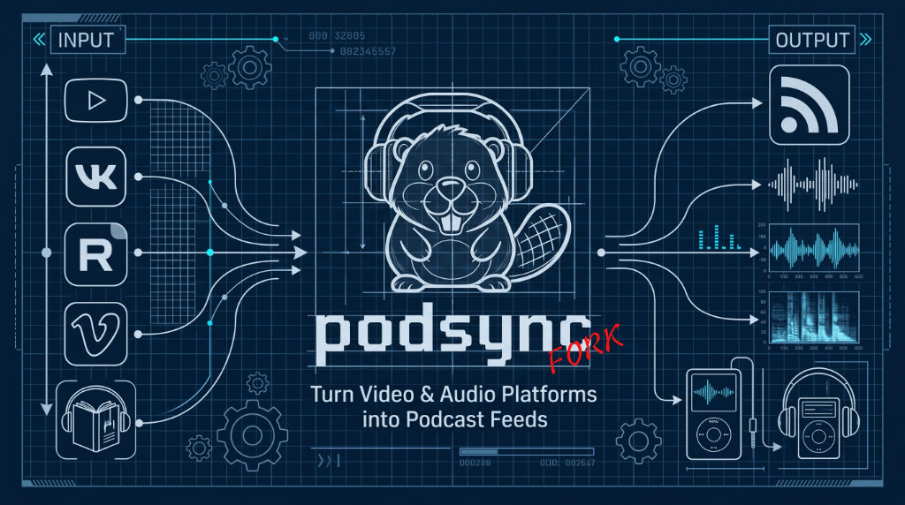

# Podsync

<p align="center"></p>
<p align="center"><b>English</b> | <a href="README_RU.md">Русский</a></p>

[](https://github.com/tatarinovms/podsync/releases/latest)
[](https://github.com/tatarinovms/podsync/pkgs/container/podsync)
[](go.mod)
[](LICENSE)

Podsync turns video channels, playlists, existing podcast feeds, and local audiobooks into podcast RSS feeds. Subscribe in your podcast app for offline listening, and manage downloads through the built-in Web Admin.

This fork extends [mxpv/podsync](https://github.com/mxpv/podsync) with personal feeds, audiobook import, a Web Admin console, and MCP integration.

[Features](#features) · [Quick start](#quick-start) · [Configuration](#configuration) · [Firefox](#firefox-extension) · [MCP](#ai-clients-and-mcp) · [Documentation](#documentation)

## Features

- **Podcast feeds:** audio/video downloads, scheduled updates, quality controls, episode filters, and retention limits.
- **Personal feeds:** curated links and uploads up to 4 GiB; rename, copy, and move episodes.
- **Audiobooks:** local folders as serial feeds with natural chapter ordering, metadata, and covers. Local audio is served without duplicating the files.
- **Web Admin:** library search, playback, retries, artwork, Activity logs, and Catppuccin light/dark themes.
- **Download settings:** cookies, HTTP/SOCKS proxies with credentials, global/per-provider routes, per-feed overrides, and URL diagnostics.
- **Operations:** REST API, MCP tools, portable backups, health endpoints, and verified native updates on supported Linux/macOS installations.
- **Telegram bot:** optional private-chat control for adding links to Personal Feeds, checking status, retrying episodes, and receiving failure and recovery alerts. Configure and enable it from Web Admin without editing `config.toml` or restarting, optionally restrict access to one Telegram user ID, and route Bot API traffic through an HTTP/SOCKS5 proxy.

### Supported sources

| Source | Scope and requirements |
|---|---|
| YouTube | Channels and playlists; YouTube Data API key for feed metadata. Downloads use yt-dlp. |
| Rutube | Channels, playlists, profiles, and individual videos; no API key required. |
| VK Video | Channels, communities, users, and playlists on `vkvideo.ru`, `vk.com`, and `vk.ru`; requires a VK token. |
| Vimeo | Channels, groups, and users; requires a Vimeo access token. |
| SoundCloud | Playlists (`/user/sets/...`), through a third-party client. |
| RSS / Apple Podcasts | Mirror a podcast RSS feed, or resolve an Apple Podcasts show URL to RSS. |
| Local files | Audiobook folders and personal-feed uploads. |

Downloads depend on source access restrictions and the installed yt-dlp version.

## Quick start

### 1. Create `config.toml`

In a new directory, save this minimal configuration. Replace the password before starting:

```toml
[server]
port = 8080
# Set a reachable public address for access from other devices:
# hostname = "https://podcast.example.com"

[server.admin]
enabled = true
username = "admin"
password = "CHANGE_ME"

[storage.local]
data_dir = "./data"

[database]
dir = "./db"
```

The full [configuration reference](config.toml.example) includes optional TLS, bind-address, and provider examples. Adapt those examples before use; it is not a minimal startup configuration.

### 2. Start Podsync

Choose Docker or a native binary.

**Docker Compose** includes yt-dlp and ffmpeg. Save this as `compose.yaml` beside `config.toml`:

```yaml
services:
  podsync:
    image: ghcr.io/tatarinovms/podsync:latest
    restart: unless-stopped
    ports:
      - "8080:8080"
    volumes:
      - ./config.toml:/app/config.toml
      - ./data:/app/data
      - ./db:/app/db
```

```bash
mkdir -p data db
docker compose pull
docker compose up -d
```

**Native binary:** extract a [release archive](https://github.com/tatarinovms/podsync/releases/latest) for Linux (`x86_64` / `arm64`), macOS Apple Silicon (`arm64`), or Windows (`x86_64`). Install yt-dlp and ffmpeg, then run from the directory containing your configuration:

```bash
./podsync --config config.toml
```

On Windows, use `./podsync.exe --config config.toml` in PowerShell. Go is only needed for [source builds](#development).

### 3. Add a feed and subscribe

Open [http://localhost:8080/admin](http://localhost:8080/admin), sign in, and add a source. Configure provider keys in **Sources & downloads** when required. Use **Personal feeds** for individual links/uploads and **Audiobooks** for local books.

Use **Subscribe** to copy the RSS URL into your podcast app. Before subscribing from another device, set `server.hostname` to an address it can reach. Use HTTPS when exposing the service over the internet.

## Configuration

Use Web Admin for everyday management. [config.toml.example](config.toml.example) documents advanced settings and environment overrides, including schedules, cleanup, normalization, filename templates, storage, and DNS.

See [Web Admin / REST API](docs/web_admin.md) for download routing, proxy credentials, cookies, Activity, and backups. The [deployment guide](docs/deployment_guide_agents.md) covers native dependencies, reverse proxies, upgrades, and backup/restore CLI commands.

See the [Telegram bot guide](docs/telegram.md) for setup, pairing, commands, and notifications.

Backups include configuration, database state, custom covers, and optional secrets. Downloaded media is excluded. Restore preserves destination storage paths and port by default.

Update Docker installations by pulling and recreating the container:

```bash
docker compose pull
docker compose up -d
```

Public `/health/live` and `/health/ready` endpoints report process liveness and database readiness. See [monitoring](docs/monitoring_uptime_kuma.md).

## Firefox extension

[Download the signed Podsync Share extension (`.xpi`)](https://github.com/tatarinovms/podsync/releases/download/v2.27.0/924c9395d5e947a39fac-1.0.5.xpi), open it in Firefox, and approve installation.

In **Connection settings**, enter your Podsync API URL (for example `https://podcast.example.com/api/v1`) and admin credentials, then approve Firefox's request for access to that server. Load your personal feeds, choose one, and send a YouTube, VK Video, or Rutube tab as audio or video. The popup stays open and confirms the feed and queued episode ID. See the [extension guide](extensions/podsync-firefox/README.md).

## AI clients and MCP

In **Access & integrations → MCP**, generate a configuration for **OpenCode v2**, **Hermes Agent**, or **Codex**. The connection check sends an authenticated MCP `initialize` request from your browser; verify the connection in the AI client as well.

Podsync supports stdio (`podsync --config config.toml --mcp`), direct HTTP JSON-RPC at `/mcp`, and SSE at `/mcp/sse`. Local configurations require the binary and config paths to exist on the client machine.

OpenCode and Codex discover the project [Podsync skill](.agents/skills/podsync/SKILL.md). For Hermes, copy the skill folder to `~/.hermes/skills/podsync/`. A skill supplies instructions; MCP needs its own configuration.

See the [MCP guide](docs/mcp.md) for examples, tools, and connection diagnostics.

## Development

Install Go as specified by [go.mod](go.mod), yt-dlp, and ffmpeg. From a source checkout:

```bash
make build
./bin/podsync --config config.toml
```

See [developer documentation](docs/dev/README.md) for architecture, tests, UI guidelines, and releases. Repository rules are in [AGENTS.md](AGENTS.md).

## Documentation

| Topic | Guides |
|---|---|
| Setup and administration | [Deployment](docs/deployment_guide_agents.md) · [Web Admin / API](docs/web_admin.md) · [Monitoring](docs/monitoring_uptime_kuma.md) |
| Library | [Personal feeds](docs/personal-feeds.md) · [Audiobooks](docs/audiobooks.md) |
| Download rules | [Episode filters](docs/filters.md) · [Cron schedules](docs/cron.md) |
| Provider credentials | [YouTube](docs/how_to_get_youtube_api_key.md) · [VK Video](docs/how_to_get_vk_token.md) · [Vimeo](docs/how_to_get_vimeo_token.md) |
| Automation | [MCP](docs/mcp.md) · [Agent skill](.agents/skills/podsync/SKILL.md) |
| Reference | [Configuration](config.toml.example) · [Developer guides](docs/dev/README.md) |

## License

[MIT](LICENSE).
