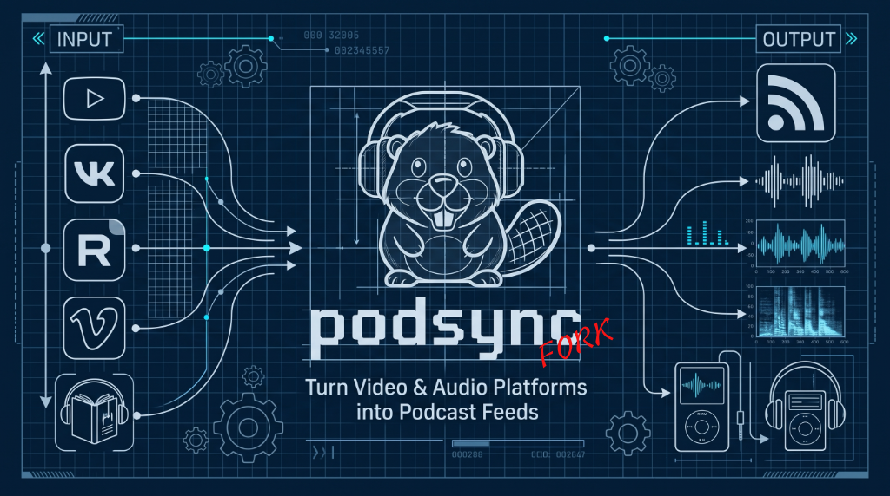

# Podsync (Fork)

<p align="center">
  
</p>

<p align="center">
  <b>English</b> | <a href="README_RU.md">Русский</a>
</p>

Podsync is a versatile, lightweight podcast generator service that turns **YouTube**, **Rutube**, **VK Video**, **Vimeo**, **SoundCloud**, **Twitch**, and **Local Audiobooks** into standard podcast RSS feeds.

Podcast applications provide superior content delivery: automatic download of new episodes in the background, position remembering and resume, synchronization between devices, and offline listening. Podsync brings this seamless experience to video platforms and your personal audio collection.

---

## Fork Features

This fork extends the original `mxpv/podsync` with powerful modern capabilities:

- **Podcast RSS Mirroring & Live Preview**: Mirror any existing third-party podcast RSS feed (`http://`, `https://`, `*.xml`) with direct HTTP media streaming straight to disk without intermediate `/tmp` buffer or RAM spikes. Features a live metadata preview card (artwork, episode count, size) and segmented **Download Scope** (`All episodes`, `Last 10`, `Last 25`, `Last 50`) that automatically syncs with `page_size` and `keep_last`, clamping episode ingestion so huge podcast archives won't exhaust your storage.
- **Smart Feed ID Transliteration & Validation**: Automatic real-time transliteration of Cyrillic (Russian, Ukrainian, Belarusian) and diacritic text into clean Latin slugs on typing and pasting (`Клан Бобров` → `KLAN_BOBROV`, `ДТКД` → `DTKD`, `Война и мир` → `voyna-i-mir`). Features instant visual validation with Catppuccin Red highlight (`is-invalid`), dynamic live RSS URL preview (`/CLANBEAVER.xml`), and strict server-side regex enforcement (`^[a-zA-Z0-9_-]+$`).
- **Responsive Mobile Navigation Drawer**: Optimized mobile layout for smartphones (`<= 767px`) with a sliding overlay navigation drawer, auto-closing on route navigation, backdrop tap, or Escape key, with cleanly isolated toggle controls.
- **Personal Feeds (Персональные ленты)**: Create custom, manually curated RSS podcast feeds directly in the Web Admin under **LIBRARY → Personal feeds** (with unified display on the main **Podcasts** tab with the `Personal` filter badge). Add individual videos from YouTube, VK Video, Rutube, direct HTTP/HTTPS media URLs, or upload local media files (up to 4 GiB) with automatic `ffmpeg` transcoding (Audio to MP3, Video to MP4). Features format and quality/resolution controls (Audio: High/Low, Video: 480p, 720p HD, 1080p Full HD...), inline episode renaming with instant RSS rebuild, copying between feeds with shared media reference counting, moving episodes (preserving GUID), and safe confirmed deletion. See [Personal Feeds Guide](./docs/personal-feeds.md).
- **Local Audiobooks & Directory Auto-Discovery**: Convert local folders of audiobooks (`.mp3`, `.m4b`, `.m4a`, `.aac`, `.ogg`) into Podcast 2.0 serial RSS feeds (`<itunes:type>serial</itunes:type>`, `<itunes:episode>N</itunes:episode>`). Features natural numeric track sorting (`01`, `02`, ..., `10`), automatic ID3/APIC cover art and metadata extraction, 1-click folder auto-discovery import, and direct file uploads in the Web UI. Active Audiobook Podcast Feeds render in the exact same clean `.feed-grid` / `.feed-card` design as regular podcasts.
- **Rutube Support**: Native support for Rutube channels, playlists, user profiles, and individual videos (`rutube.ru/channel/...`, `rutube.ru/plst/...`, `rutube.ru/u/...`, `rutube.ru/video/...`) powered by `yt-dlp` with zero API keys required.
- **VK Video Support**: Convert VK Video channels, public communities, users, and playlists into podcast feeds (`vkvideo.ru`, `vk.com`, `vk.ru`).
- **Web Admin Console (`/admin`)**: Built-in responsive web dashboard with sidebar navigation (Podcasts, Audiobooks, Activity, API keys, Downloader, System & storage, MCP server), list and grid views, dedicated podcast detail page with chapters/episodes, search, sorting, status badges, audio playback link, episode retry, and direct **Delete podcast** button in the header. Features custom cover art upload with live preview, ready-to-use RSS links, 1-click clipboard copy, QR codes for instant smartphone subscribing, and deep-links for Apple Podcasts / Pocket Casts / Overcast. See [Web Admin Guide](./docs/web_admin.md).
- **Brute-Force Protection & Security Settings**: Sliding-window rate limiter protecting web login and HTTP Basic Auth from brute-force attacks, configurable via Web UI, environment variables, or `config.toml` (max failed attempts, observation window, lockout duration).
- **Real-Time In-Memory System Logs**: Built-in log console in the web admin with live auto-refresh (2s polling), search/filter by keyword, level filtering (DEBUG, INFO, WARN, ERROR), dynamic on-the-fly log level switching, and 1-click log download.
- **Downloader & Dependency Diagnostics**: Live status and version detection for both `yt-dlp` and `ffmpeg`, Netscape `cookies.txt` management (upload/view/clear, extract from browser) to bypass YouTube bot checks, HTTP/SOCKS5 proxy configuration, and live URL extraction test.
- **Smart Token Extraction**: Paste the entire OAuth redirect URL when adding VK API tokens — Podsync automatically parses out the access token.
- **Accurate Disk Usage & Active Episodes**: Card metrics accurately reflect only active (downloaded) episodes and their true disk footprint, while cleaned/purged episodes are clearly distinguished in episode inspection.
- **Catppuccin Mocha & Latte Themes**: Strict Catppuccin color scheme in the web console with seamless dark/light switching, custom pastel status badges, and smooth animations.
- **Model Context Protocol (MCP) Server**: Built-in MCP server with 28 tools for AI coding assistants (**OpenCode**, **Hermes Agent**, **Claude Desktop**, **Cursor**, **Cline**, **Antigravity**) with stdio and SSE transport, pre-configured agent skill ([`.agents/skills/podsync/SKILL.md`](./.agents/skills/podsync/SKILL.md)), and 1-click config generator. See [MCP Guide](./docs/mcp.md).
- **Configurable `filename_template`**: Customize media filenames and RSS enclosure paths (e.g. `{{id}}`, `{{title}}`, `{{pub_date}}`).
- **One-Time Filename Migration**: CLI tool (`--migrate-filenames`, `--migrate-filenames-dry-run`) to rename existing downloaded media to match a new template.
- **Extended Environment Variables**: Full support for containerized deployments with environment overrides for admin, security, tokens, downloaders, and audiobooks.

## Features

- Works with YouTube, Rutube, VK Video, Vimeo, SoundCloud, Twitch, local Audiobooks, and third-party Podcast RSS mirrors.
- Supports feeds configuration: video/audio, quality profile, max video height ceiling, and download scope limits.
- mp3 encoding with ffmpeg.
- Direct-to-disk streaming downloads avoiding `/tmp` storage exhaustion.
- Podcast 2.0 Serial feed specifications for audiobooks with chapter tracking and embedded/external artwork.
- Update scheduler supports cron expressions.
- Episode filtering (match by title regex, duration min/max, max age).
- Feed customizations (custom artwork upload with live preview, category, language, etc.).
- OPML export.
- Automatic episode cleanup (keep last X episodes).
- Configurable hooks for custom integrations and post-download workflows.
- In-memory real-time log viewer with dynamic log levels.
- Built-in brute-force protection and login rate limiting.
- Runs on Windows, macOS, Linux, and Docker.
- Supports ARM (arm64, armv7) and x86_64 architectures.
- Supports API keys rotation for quota management.

## Dependencies

If you are running Podsync as a binary (e.g. not via Docker), make sure the following dependencies are installed on your system: `yt-dlp`, `ffmpeg`, and `go` (if building from source).

On macOS:
```bash
brew install yt-dlp ffmpeg go
```

On Ubuntu/Debian:
```bash
sudo apt-get update && sudo apt-get install -y ffmpeg
# Install yt-dlp:
sudo curl -L https://github.com/yt-dlp/yt-dlp/releases/latest/download/yt-dlp -o /usr/local/bin/yt-dlp
sudo chmod a+rx /usr/local/bin/yt-dlp
```

## Documentation

- [Developer documentation](./docs/dev/README.md)
- [Deployment & Setup Guide for Agents (OpenCode, Hermes)](./docs/deployment_guide_agents.md)
- [Web Admin Console Guide](./docs/web_admin.md)
- [Audiobooks Guide](./docs/audiobooks.md)
- [Model Context Protocol (MCP) Guide](./docs/mcp.md)
- [How to get VK API token](./docs/how_to_get_vk_token.md)
- [How to get YouTube API Key](./docs/how_to_get_youtube_api_key.md)
- [How to get Vimeo API token](./docs/how_to_get_vimeo_token.md)
- [Podsync on Synology NAS Guide](./docs/how_to_setup_podsync_on_synology_nas.md)
- [Podsync on QNAP NAS Guide](./docs/how_to_setup_podsync_on_qnap_nas.md)
- [Schedule updates with cron](./docs/cron.md)
- [Filter episodes with regex](./docs/filters.md)

### Access tokens

To query YouTube, Vimeo, or VK Video APIs you need an API token (Rutube requires no API token):

- [How to get VK API token](./docs/how_to_get_vk_token.md) *(Podsync automatically extracts the token if you paste the entire callback URL)*
- [How to get YouTube API key](https://elfsight.com/blog/2016/12/how-to-get-youtube-api-key-tutorial/)
- [Generate an access token for Vimeo](https://developer.vimeo.com/api/guides/start#generate-access-token)

## Configuration

Podsync uses a TOML configuration file (e.g. `config.toml`). See [config.toml.example](./config.toml.example) for a complete reference.

Example configuration:

```toml
[server]
port = 8080
# hostname = "https://podcast.example.com" # Optional public URL behind reverse proxy

[server.admin]
enabled = true
username = "admin"
password = "secretpassword"

[storage]
  [storage.local]
  data_dir = "/app/data/"

[audiobooks]
dir = "/app/data/audiobooks" # Root directory for audiobook folders
supported_extensions = [".mp3", ".m4b", ".m4a", ".aac", ".ogg"]
cover_filenames = ["cover.jpg", "cover.jpeg", "cover.png", "folder.jpg"]

[tokens]
vkvideo = "YOUR_VK_TOKEN"    # Or set via PODSYNC_VKVIDEO_API_KEY
youtube = "YOUR_YOUTUBE_KEY" # Or set via PODSYNC_YOUTUBE_API_KEY

[feeds]
  # VK Video channel
  [feeds.CLANBEAVER]
  url = "https://vkvideo.ru/@clanbeaver"
  page_size = 10
  quality = "high"
  format = "video"

  # Rutube channel (no API key required)
  [feeds.RUTUBE_SAMPLE]
  url = "https://rutube.ru/channel/25758171/"
  page_size = 10
  quality = "high"
  format = "audio"

  # Local Audiobook feed
  [feeds.WAR_AND_PEACE]
  url = "audiobook://War_and_Peace" # Points to /app/data/audiobooks/War_and_Peace
  title = "War and Peace"
  author = "Leo Tolstoy"
  format = "audio"
```

### Environment Variables

All key settings can be configured via environment variables:

| Variable Name | Description | Example Value(s) |
|---|---|---|
| `PODSYNC_CONFIG_PATH` | Path to the configuration file (overrides `--config`) | `/app/config.toml` |
| `PODSYNC_ADMIN_ENABLED` | Enable web admin console (`true` or `false`) | `true` |
| `PODSYNC_ADMIN_USERNAME` | Admin web console username | `admin` |
| `PODSYNC_ADMIN_PASSWORD` | Admin web console password | `secretpassword` |
| `PODSYNC_ADMIN_MAX_ATTEMPTS` | Maximum failed login attempts before lockout | `5` |
| `PODSYNC_ADMIN_WINDOW` | Observation window for failed attempts | `5m` |
| `PODSYNC_ADMIN_LOCKOUT` | Lockout duration after exceeding max attempts | `15m` |
| `PODSYNC_JOBS_WORKERS` | Concurrent job queue download workers | `2` |
| `PODSYNC_AUDIOBOOKS_DIR` | Root directory for local audiobook folders | `/app/data/audiobooks` |
| `PODSYNC_VKVIDEO_API_KEY` | VK Video token(s), space-separated for rotation (alias: `PODSYNC_VK_API_KEY`) | `vk_token1 vk_token2` |
| `PODSYNC_YOUTUBE_API_KEY` | YouTube API key(s), space-separated for rotation | `key1 key2 key3` |
| `PODSYNC_VIMEO_API_KEY` | Vimeo API key(s), space-separated for rotation | `key1 key2` |
| `PODSYNC_SOUNDCLOUD_API_KEY` | SoundCloud API key(s), space-separated for rotation | `key1 key2` |
| `PODSYNC_TWITCH_API_KEY` | Twitch API credentials (`CLIENT_ID:CLIENT_SECRET`) | `id1:secret1 id2:secret2` |
| `PODSYNC_DOWNLOADER_COOKIES_FILE` | Path to Netscape `cookies.txt` file for yt-dlp | `/app/data/cookies.txt` |
| `PODSYNC_DOWNLOADER_COOKIES_FROM_BROWSER` | Browser name to extract cookies from (e.g. chrome, firefox, safari, brave) | `chrome` or `firefox:Default` |
| `PODSYNC_DOWNLOADER_PROXY` | HTTP/HTTPS/SOCKS5 proxy URL for yt-dlp downloader traffic | `socks5://127.0.0.1:1080` |
| `PODSYNC_DOWNLOADER_CUSTOM_BINARY` | Custom binary path for yt-dlp | `/usr/local/bin/yt-dlp` |

### Local audiobooks

Place each book in a separate subfolder of `[audiobooks].dir` and import it from
**Admin → Audiobooks**. See the [Audiobooks Guide](./docs/audiobooks.md) for Docker
mounts, file uploads, and updates.

## Web Admin Console & REST API

Podsync includes a built-in web management console accessible at `/admin`. See the [Web Admin Console Guide](./docs/web_admin.md) for full instructions and screenshots.

### REST API Endpoints

All admin endpoints support **HTTP Basic Auth** (`-u username:password`) and browser session cookies:

| Method | Endpoint | Description |
|---|---|---|
| `GET` | `/health` | Health check endpoint (public, unauthenticated) |
| `GET` | `/health/live` | Public process liveness probe |
| `GET` | `/health/ready` | Public database readiness probe, independent of episode download errors |
| `GET` | `/api/v1/auth/status` | Current authentication status |
| `POST` | `/api/v1/auth/login` | Session login with JSON credentials |
| `POST` | `/api/v1/auth/logout` | Session logout |
| `POST` | `/api/v1/auth/password` | Change admin password |
| `GET`, `POST` | `/api/v1/auth/security` | View or update brute-force rate limiting settings |
| `GET` | `/api/v1/feeds` | List all podcast feeds with active episode counts and disk usage |
| `POST` | `/api/v1/feeds` | Add new channel/playlist/RSS mirror feed with auto-sync to `config.toml` |
| `POST` | `/api/v1/feeds/preview` | Live preview for feeds/RSS mirrors (title, author, cover, episodes, size) |
| `GET` | `/api/v1/feeds/status` | Lightweight in-memory feed states (idle, queued, running) |
| `POST` | `/api/v1/feeds/update` | Trigger bulk update for all configured feeds at once |
| `GET` | `/api/v1/feeds/{id}` | Detailed feed info and episode status |
| `GET` | `/api/v1/feeds/{id}/episodes` | Paginated episodes with `limit`, `offset`, `status`, `q`, `sort`, and `duration` filters |
| `PUT`, `PATCH` | `/api/v1/feeds/{id}` | Update feed configuration and trigger XML rebuild |
| `DELETE` | `/api/v1/feeds/{id}` | Delete feed (`?delete_files=true` to purge downloaded media) |
| `POST` | `/api/v1/feeds/{id}/update` | Trigger immediate feed update and download cycle |
| `POST` | `/api/v1/feeds/{id}/cover` | Attach uploaded cover directly to a specific feed |
| `POST` | `/api/v1/covers/upload` | Upload custom cover image file (JPEG, PNG, WebP) with live preview |
| `POST` | `/api/v1/feeds/{id}/episodes/{ep_id}/retry` | Reset failed episode status for retry |
| `GET` | `/api/v1/personal-feeds` | List all personal curated podcast feeds |
| `POST` | `/api/v1/personal-feeds` | Create new personal feed (`title`, `format`, optional `cover_art`, etc.) |
| `GET` | `/api/v1/personal-feeds/{id}` | Detailed personal feed metadata and episode list |
| `PATCH` | `/api/v1/personal-feeds/{id}` | Update personal feed configuration (title, description, cover, sort) |
| `DELETE` | `/api/v1/personal-feeds/{id}` | Delete personal feed (`?confirm=true&delete_files=true`) |
| `GET` | `/api/v1/personal-feeds/{id}/episodes` | List episodes of a personal feed |
| `POST` | `/api/v1/personal-feeds/{id}/episodes` | Add episode by single video URL (YouTube, VK, Rutube, direct media) |
| `POST` | `/api/v1/personal-feeds/{id}/upload` | Upload local audio/video file up to 4 GiB with auto-transcoding |
| `DELETE` | `/api/v1/personal-feeds/{id}/episodes/{ep_id}` | Remove episode from feed (`?confirm=true&delete_files=true`) |
| `POST` | `/api/v1/personal-feeds/{id}/episodes/{ep_id}/copy` | Copy episode to another feed (shared media, new stable GUID) |
| `POST` | `/api/v1/personal-feeds/{id}/episodes/{ep_id}/move` | Move episode to another feed (preserves existing GUID) |
| `POST` | `/api/v1/personal-feeds/{id}/episodes/{ep_id}/retry` | Retry failed personal episode download |
| `GET` | `/api/v1/audiobooks/dirs` | Auto-discover subdirectories in audiobooks path with file count & cover status |
| `DELETE` | `/api/v1/audiobooks/dirs` | Delete local audiobook folder and audio files from disk (`?name=...`) |
| `POST` | `/api/v1/audiobooks/import` | Create a new podcast feed from a discovered local audiobook folder |
| `POST` | `/api/v1/audiobooks/upload` | Upload audio files and cover art directly to create an audiobook feed |
| `GET` | `/api/v1/audiobooks/config` | Get audiobook configuration and root path status |
| `GET` | `/api/v1/system/logs` | Query in-memory system logs (supports `?limit=100&level=INFO&search=...`) |
| `DELETE` | `/api/v1/system/logs` | Clear in-memory log buffer |
| `GET` | `/api/v1/system/logs/level` | Get current active log level (`debug`, `info`, `warn`, `error`) |
| `POST` | `/api/v1/system/logs/level` | Dynamically update active log level on the fly |
| `GET` | `/api/v1/system/logs/download` | Download full log history as plain text |
| `GET` | `/api/v1/system/errors` | List download errors with diagnostic causes and recommendations |
| `GET` | `/api/v1/system/recent` | List recent successfully downloaded episodes |
| `GET` | `/api/v1/system/status` | High-level status snapshot (sync schedules, 24h count, active errors) |
| `GET` | `/api/v1/system` | System metrics (RAM, uptime, disk space, yt-dlp & ffmpeg versions) |
| `GET` | `/api/v1/tokens` | Get masked API tokens for all providers |
| `POST` | `/api/v1/tokens` | Update API tokens (supports key rotation and URL parsing) |
| `DELETE` | `/api/v1/tokens` | Delete token by `?provider=...&index=...` |
| `GET` | `/api/v1/downloader` | Get yt-dlp/ffmpeg downloader settings, cookie status, and proxy |
| `POST` | `/api/v1/downloader` | Update downloader settings (timeout, proxy, browser, self-update) |
| `GET` | `/api/v1/downloader/cookies` | Get Netscape cookies.txt content |
| `POST` | `/api/v1/downloader/cookies` | Save or upload new Netscape cookies.txt content |
| `DELETE` | `/api/v1/downloader/cookies` | Clear and delete installed cookies.txt file |
| `POST` | `/api/v1/downloader/test` | Test URL extraction with yt-dlp and configured cookies/proxy |
| `GET` | `/api/v1/mcp/config` | Fetch MCP connection parameters for agents |

## Model Context Protocol (MCP) Server

Podsync includes a built-in **MCP Server** with 28 tools that allows AI coding assistants (**OpenCode**, **Claude Desktop**, **Cursor**, **Cline**, and **Antigravity**) to directly inspect and manage feeds, trigger downloads, retry errors, import audiobooks, view logs, and monitor system health.

An agent skill definition is provided in [`.agents/skills/podsync/SKILL.md`](./.agents/skills/podsync/SKILL.md). See the [MCP Guide](./docs/mcp.md) for full details and setup instructions.

### MCP Tools:
- **Feed Management**: `list_feeds`, `get_feed`, `add_feed`, `delete_feed`, `update_feed`, `update_all_feeds`, `update_feed_config`, `retry_episode`
- **Personal Feeds**: `list_personal_feeds`, `get_personal_feed`, `create_personal_feed`, `add_personal_episode`, `delete_personal_episode`, `rename_personal_episode`
- **Audiobooks**: `list_audiobook_dirs`, `import_audiobook`, `delete_audiobook_dir`
- **System & Logs**: `get_system_stats`, `get_sync_status`, `get_recent_downloads`, `get_download_errors`, `get_system_logs`
- **Downloader & Diagnostics**: `get_downloader_config`, `update_downloader_config`, `test_downloader`
- **Tokens**: `get_tokens`, `update_tokens`, `delete_tokens`

### How to use MCP:
- **Stdio Mode (Claude Desktop, Cursor)**:
  ```bash
  ./bin/podsync --config config.toml --mcp
  ```
  *(Automatically relays JSON-RPC to the running instance's `POST /mcp`, including personal-feed tools, or operates standalone with the local database).*
- **HTTP / SSE Mode**: Available at `/mcp` and `/mcp/sse` when the web server is running.

Both connection modes provide all 28 tools. For a complete library inventory,
call `list_feeds` for channels and audiobooks and `list_personal_feeds` for curated
personal feeds. In proxy mode, `serverInfo.version` reports the daemon's build
version. See [MCP troubleshooting](./docs/mcp.md#troubleshooting-older-stdio-clients)
if an older stdio client reports that personal feeds are unavailable.

## How to run

### Download prebuilt binary:

Download precompiled release archives for your OS/architecture from [GitHub Releases](https://github.com/tatarinovms/podsync/releases):

```bash
# Automated download script for Linux (x86_64 / arm64)
curl -sSL https://raw.githubusercontent.com/tatarinovms/podsync/main/docs/deployment_guide_agents.md
```

### Build from source:

```bash
make
./bin/podsync --config config.toml

# Optional CLI flags:
# ./bin/podsync --config config.toml --admin     # Force enable web admin console (/admin)
# ./bin/podsync --config config.toml --no-admin  # Force disable web admin console (/admin)
# ./bin/podsync --config config.toml --mcp       # Run as MCP server over stdio for AI assistants
```

### One-time filename migration

If you changed `filename_template` and want to migrate already-downloaded files:

```bash
./bin/podsync --config config.toml --migrate-filenames
```

Preview only (no writes):

```bash
./bin/podsync --config config.toml --migrate-filenames --migrate-filenames-dry-run
```

### Run via Docker:

Pull and run prebuilt container image:

```bash
docker run \
    -p 8080:8080 \
    -v $(pwd)/data:/app/data/ \
    -v $(pwd)/db:/app/db/ \
    -v $(pwd)/config.toml:/app/config.toml \
    ghcr.io/tatarinovms/podsync:latest
```

Or build locally:
```bash
make docker
```

The build context excludes Git history, documentation, agent skills, local
configuration, databases, and downloaded media. `make docker` passes the version
and commit as build arguments. With `docker build`, set `--build-arg TAG=...` and
`--build-arg COMMIT=...` to supply metadata; defaults are `dev` and `unknown`.

### Run via Docker Compose:

```yaml
services:
  podsync:
    container_name: podsync
    build: .
    image: ghcr.io/tatarinovms/podsync:latest
    restart: unless-stopped
    ports:
      - 8080:8080
    volumes:
      - ./data:/app/data/
      - ./db:/app/db/
      - ./config.toml:/app/config.toml
```

```bash
docker compose up -d
```

## License

This project is licensed under the MIT License - see the [LICENSE](LICENSE) file for details.
