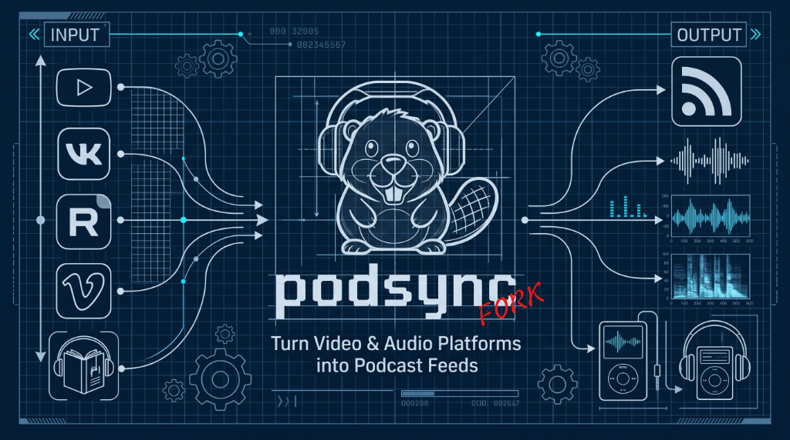

# Podsync

<p align="center">
  
</p>

<p align="center">
  <a href="README.md">English</a> | <b>Русский</b>
</p>

[](https://github.com/tatarinovms/podsync/releases/latest)
[](https://github.com/tatarinovms/podsync/pkgs/container/podsync)
[](go.mod)
[](LICENSE)

[Ключевые возможности](#ключевые-возможности) • [Быстрый старт](#быстрый-старт) • [Конфигурация](#конфигурация) • [Web Admin и REST API](#веб-панель-администратора-и-rest-api) • [MCP Server](#сервер-model-context-protocol-mcp) • [Документация](#документация)

Podsync — лёгкий генератор подкастов, который превращает видео, аудио, локальные папки аудиокниг и готовые Podcast RSS в стандартные podcast-ленты. Подкаст-приложения скачивают новые эпизоды в фоне, помнят позицию прослушивания, синхронизируют устройства и поддерживают офлайн-воспроизведение.

Этот форк расширяет исходный `mxpv/podsync` возможностями, описанными ниже.

## Ключевые возможности

### 1. Источники разных платформ и зеркалирование RSS

- Создавайте стандартные podcast RSS-ленты из **YouTube, Rutube, VK Video, Vimeo, SoundCloud**, локальных аудиокниг и сторонних Podcast RSS. Rutube поддерживает каналы, плейлисты, профили и отдельные видео без API-ключа; VK Video поддерживает каналы, сообщества, пользователей и плейлисты на `vkvideo.ru`, `vk.com` и `vk.ru`.
- Зеркалируйте любой Podcast RSS по `http://`, `https://` или `*.xml` с живым предпросмотром метаданных (обложка, число эпизодов и размер) и потоковой записью медиа на диск без промежуточного `/tmp` и пиков потребления RAM.
- Выбирайте объём загрузки: **все эпизоды**, **последние 10**, **25** или **50**. Он синхронизируется с `page_size` и `keep_last`, ограничивая большой архив до исчерпания диска.
- Настраивайте видео/аудиоформат, профиль качества, максимальную высоту видео, cron-обновления, обложку с предпросмотром, категорию, язык, экспорт OPML, автоматическую очистку последних *X* эпизодов, ротацию API-ключей и хуки/webhooks после загрузки. Podsync работает в Windows (`x86_64`), macOS (`arm64`), Linux (`x86_64`, `arm64`) и Docker.

### 2. Персональные ленты и добавление в один клик

- Создавайте вручную отобранные ленты в **Library → Personal feeds**; они также отображаются в Podcasts с фильтром Personal. Добавляйте YouTube, VK Video, Rutube, прямые HTTP/HTTPS-медиа URL или локальные файлы размером до **4 ГиБ**.
- `ffmpeg` автоматически преобразует аудио в MP3, видео — в MP4. Выбирайте высокое или низкое качество аудио либо разрешение видео (480p, 720p HD, 1080p Full HD и выше), переименовывайте эпизод с немедленной перестройкой RSS, копируйте его с общим медиафайлом, переносите с сохранением GUID или безопасно удаляйте. См. [руководство по персональным лентам](./docs/ru/personal-feeds.md).
- Используйте `POST` или `GET /api/v1/personal-feeds/{id}/quick-add` с токеном ленты из iOS Shortcuts, меню «Поделиться» iOS или bookmarklet браузера.

### 3. Локальные аудиокниги (Podcast 2.0 Serial)

- Автоматически находите папки с `.mp3`, `.m4b`, `.m4a`, `.aac` или `.ogg`, импортируйте их в один клик либо загружайте файлы прямо в Web Admin.
- Создавайте серийные ленты Podcast 2.0 с `<itunes:type>serial</itunes:type>` и `<itunes:episode>N</itunes:episode>`, естественной числовой сортировкой (`01`, `02`, …, `10`) и автоматическим извлечением метаданных и встроенной ID3/APIC-обложки.

### 4. Обработка аудио и Podcasting 2.0

- Кодируйте MP3 через `ffmpeg` и нормализуйте звук по EBU R128 через `normalize_audio = true` и `loudnorm=I=-16:TP=-1.5:LRA=11`, совместимо с Apple Podcasts и Spotify.
- Преобразуйте таймкоды описания в JSON Podcasting 2.0 `<podcast:chapters>` и встраивайте главы ID3/MP4 с `--embed-chapters`.
- Отсекайте активные стримы и будущие премьеры через `ignore_live = true`; также доступны фильтры по regex заголовка, длительности и максимальному возрасту.
- Задавайте имена медиа через `filename_template` (`{{id}}`, `{{title}}`, `{{pub_date}}`) и переименовывайте существующие файлы через `--migrate-filenames` или `--migrate-filenames-dry-run`.

### 5. Веб-панель Catppuccin (`/admin`)

- Управляйте библиотекой в адаптивной панели с темами Mocha и Latte, доступным мобильным меню, списком и сеткой, поиском, сортировкой, повторными загрузками, загрузкой обложек и точными метриками диска для скачанных эпизодов.
- Используйте нижний мини-плеер для просмотра кодека и битрейта, перемотки на -15/+30 секунд, выбора скорости и переходов по главам. Делитесь лентой через QR-коды, копирование ссылки и deeplink для Apple Podcasts, Pocket Casts или Overcast.
- У каждого подкаста есть отдельная страница с главами и эпизодами, статусами, ссылками на воспроизведение и скачивание, повторной попыткой и прямым удалением.
- ID лент транслитерируют кириллицу (русский, украинский и белорусский) и диакритику в проверенные латинские slug с живым предпросмотром RSS URL. Панель также содержит логи с опросом раз в две секунды, поиск и уровни логов, скачивание логов, настраиваемую защиту от перебора и нативные обновления с проверкой SHA-256.

### 6. Обход блокировок, прокси и сеть

- Направляйте трафик через общий или отдельный HTTP/SOCKS5-прокси для каждого провайдера в `[downloader.proxies]`, переопределяйте прокси на уровне ленты и по умолчанию используйте прямое соединение. Поддерживаются переменные `PODSYNC_DOWNLOADER_PROXY_*`.
- Управляйте Netscape `cookies.txt`, извлекайте куки из локального браузера и запускайте живой тест URL через yt-dlp для диагностики bot-check и age-gate. Настраивайте `dns_servers` для API провайдеров и RSS-метаданных; yt-dlp продолжает использовать системный DNS.
- Вставьте полный URL редиректа VK OAuth — Podsync автоматически извлечёт access token.
- Экспортируйте полный системный `.tar.gz` бэкап конфигурации, согласованного снимка Badger и пользовательских обложек; его можно проверить и восстановить из Web Admin, CLI или MCP. Скачанные медиафайлы не включаются.

## Быстрый старт

### Docker Compose (рекомендуется)

```yaml
services:
  podsync:
    container_name: podsync
    build: .
    image: ghcr.io/tatarinovms/podsync:latest
    restart: unless-stopped
    ports:
      - 8080:8080
    volumes:
      - ./data:/app/data/
      - ./db:/app/db/
      - ./config.toml:/app/config.toml
```

```bash
docker compose up -d
```

### Docker CLI

```bash
docker run \
    -p 8080:8080 \
    -v $(pwd)/data:/app/data/ \
    -v $(pwd)/db:/app/db/ \
    -v $(pwd)/config.toml:/app/config.toml \
    ghcr.io/tatarinovms/podsync:latest
```

Или локальная сборка образа:
```bash
make docker
```

Из контекста сборки исключены история Git, документация, навыки агентов,
локальная конфигурация, базы данных и загруженные медиафайлы. `make docker`
передаёт версию и коммит как аргументы сборки. При вызове `docker build`
задавайте `--build-arg TAG=...` и `--build-arg COMMIT=...`; значения по умолчанию —
`dev` и `unknown`.

### Готовые бинарные сборки

Скачайте архив для вашей ОС и архитектуры процессора со страницы [GitHub Releases](https://github.com/tatarinovms/podsync/releases). Команды с определением архитектуры и установкой приведены в [руководстве по развёртыванию](./docs/ru/deployment_guide_agents.md).

### Сборка из исходников

```bash
make
./bin/podsync --config config.toml

# Дополнительные флаги запуска:
# ./bin/podsync --config config.toml --admin     # Принудительно включить веб-панель (/admin)
# ./bin/podsync --config config.toml --no-admin  # Принудительно отключить веб-панель (/admin)
# ./bin/podsync --config config.toml --mcp       # Запуск в режиме MCP-сервера через stdio
```

### Системные зависимости

Если вы запускаете Podsync как бинарный файл (не через Docker), убедитесь, что в системе установлены: `yt-dlp`, `ffmpeg` и `go` (для сборки из исходников).

На macOS:
```bash
brew install yt-dlp ffmpeg go
```

На Ubuntu/Debian:
```bash
sudo apt-get update && sudo apt-get install -y ffmpeg
# Установка актуальной версии yt-dlp:
sudo curl -L https://github.com/yt-dlp/yt-dlp/releases/latest/download/yt-dlp -o /usr/local/bin/yt-dlp
sudo chmod a+rx /usr/local/bin/yt-dlp
```

### Миграция имён файлов

Если вы изменили шаблон `filename_template` и хотите переименовать уже скачанные файлы:

```bash
./bin/podsync --config config.toml --migrate-filenames
```

Режим предпросмотра (без физического переименования):

```bash
./bin/podsync --config config.toml --migrate-filenames --migrate-filenames-dry-run
```

### Резервная копия и восстановление без Web Admin

```bash
./bin/podsync --config config.toml --export-backup ./podsync-backup.tar.gz
./bin/podsync --config config.toml --restore-backup ./podsync-backup.tar.gz --preserve-paths
```

При восстановлении через CLI пути к хранилищу и порт текущего сервера сохраняются по умолчанию. Используйте `--no-preserve-paths`, только если пути и порт из бэкапа должны заменить настройки целевого сервера.

Архив не содержит скачанные медиафайлы. При восстановлении пути хранилища и порт целевого сервера сохраняются по умолчанию.

## Конфигурация

Podsync использует конфигурационный файл TOML (например, `config.toml`). Полный перечень параметров смотрите в [config.toml.example](./config.toml.example).

Пример конфигурации:

```toml
[server]
port = 8080
# hostname = "https://podcast.example.com" # Опциональный публичный URL за reverse proxy

[server.admin]
enabled = true
username = "admin"
password = "secretpassword"

[storage]
  [storage.local]
  data_dir = "/app/data/"

[audiobooks]
dir = "/app/data/audiobooks" # Корневая папка для папок с аудиокнигами
supported_extensions = [".mp3", ".m4b", ".m4a", ".aac", ".ogg"]
cover_filenames = ["cover.jpg", "cover.jpeg", "cover.png", "folder.jpg"]

[tokens]
vkvideo = "YOUR_VK_TOKEN"    # Или через переменную PODSYNC_VKVIDEO_API_KEY
youtube = "YOUR_YOUTUBE_KEY" # Или через переменную PODSYNC_YOUTUBE_API_KEY

[feeds]
  # Канал VK Видео
  [feeds.CLANBEAVER]
  url = "https://vkvideo.ru/@clanbeaver"
  page_size = 10
  quality = "high"
  format = "video"

  # Канал Rutube (ключ API не требуется)
  [feeds.RUTUBE_SAMPLE]
  url = "https://rutube.ru/channel/25758171/"
  page_size = 10
  quality = "high"
  format = "audio"

  # Фид локальной аудиокниги
  [feeds.WAR_AND_PEACE]
  url = "audiobook://War_and_Peace" # Указывает на папку /app/data/audiobooks/War_and_Peace
  title = "Война и мир"
  author = "Лев Толстой"
  format = "audio"
```

### Переменные окружения

Основные параметры можно переопределять через переменные окружения:

| Имя переменной | Описание | Пример значения |
|---|---|---|
| `PODSYNC_CONFIG_PATH` | Путь к файлу конфигурации (переопределяет флаг `--config`) | `/app/config.toml` |
| `PODSYNC_ADMIN_ENABLED` | Включение веб-панели управления (`true` или `false`) | `true` |
| `PODSYNC_ADMIN_USERNAME` | Логин администратора веб-панели | `admin` |
| `PODSYNC_ADMIN_PASSWORD` | Пароль администратора веб-панели | `secretpassword` |
| `PODSYNC_ADMIN_MAX_ATTEMPTS` | Максимум неудачных попыток входа до блокировки | `5` |
| `PODSYNC_ADMIN_WINDOW` | Окно наблюдения за неудачными попытками | `5m` |
| `PODSYNC_ADMIN_LOCKOUT` | Длительность блокировки после исчерпания попыток | `15m` |
| `PODSYNC_JOBS_WORKERS` | Число параллельных воркеров очереди загрузок | `2` |
| `PODSYNC_AUDIOBOOKS_DIR` | Корневая директория для поиска аудиокниг | `/app/data/audiobooks` |
| `PODSYNC_DNS_SERVERS` | IP DNS-серверов через пробел или запятую для API провайдеров и RSS-метаданных | `1.1.1.1,9.9.9.9` |
| `PODSYNC_VKVIDEO_API_KEY` | Токены VK Видео (через пробел для ротации, алиас: `PODSYNC_VK_API_KEY`) | `vk_token1 vk_token2` |
| `PODSYNC_YOUTUBE_API_KEY` | Ключи YouTube API (через пробел для ротации) | `key1 key2 key3` |
| `PODSYNC_VIMEO_API_KEY` | Ключи Vimeo API (через пробел для ротации) | `key1 key2` |
| `PODSYNC_SOUNDCLOUD_API_KEY` | Ключи SoundCloud API (через пробел) | `key1 key2` |
| `PODSYNC_DOWNLOADER_COOKIES_FILE` | Путь к файлу Netscape `cookies.txt` для yt-dlp | `/app/data/cookies.txt` |
| `PODSYNC_DOWNLOADER_COOKIES_FROM_BROWSER` | Имя браузера для импорта кук (chrome, firefox, safari, brave) | `chrome` или `firefox:Default` |
| `PODSYNC_DOWNLOADER_PROXY` | URL прокси HTTP/HTTPS/SOCKS5 для загрузчика | `socks5://127.0.0.1:1080` |
| `PODSYNC_DOWNLOADER_CUSTOM_BINARY` | Путь к кастомному исполняемому файлу yt-dlp | `/usr/local/bin/yt-dlp` |

### Локальные аудиокниги

Поместите каждую книгу в отдельную подпапку `[audiobooks].dir` и импортируйте её
через **Admin → Audiobooks**. Настройка томов Docker, загрузка файлов и обновление
книг описаны в [руководстве по аудиокнигам](./docs/ru/audiobooks.md).

## Веб-панель администратора и REST API

Podsync предоставляет встроенную панель управления по адресу `/admin`. Она использует cookie сессии браузера и поддерживает HTTP Basic Auth (`-u username:password`) для административного API. Подробности и скриншоты — в [руководстве по Web Admin](./docs/ru/web_admin.md).

<details>
<summary><strong>Показать все эндпоинты REST API (50+ маршрутов)</strong></summary>

| Метод | Эндпоинт | Описание |
|---|---|---|
| `GET` | `/health` | Диагностика, включая недавние ошибки загрузки (публичный доступ) |
| `GET` | `/health/live` | Проверка доступности процесса (публичный доступ) |
| `GET` | `/health/ready` | Проверка готовности БД независимо от ошибок загрузки (публичный доступ) |
| `GET` | `/api/v1/auth/status` | Текущий статус аутентификации |
| `POST` | `/api/v1/auth/login` | Вход в сессию по логину и паролю |
| `POST` | `/api/v1/auth/logout` | Выход из сессии |
| `POST` | `/api/v1/auth/password` | Смена пароля администратора |
| `GET`, `POST` | `/api/v1/auth/security` | Просмотр и изменение настроек rate limiting защиты от перебора |
| `GET` | `/api/v1/feeds` | Список всех лент со статистикой активных эпизодов и объёмом на диске |
| `POST` | `/api/v1/feeds` | Добавление новой ленты (канал/плейлист/зеркало RSS) с записью в `config.toml` |
| `POST` | `/api/v1/feeds/preview` | Предпросмотр метаданных ленты/RSS-зеркала (название, автор, обложка, число глав, размер) |
| `GET` | `/api/v1/feeds/status` | Быстрый статус лент в памяти (idle, queued, running) |
| `POST` | `/api/v1/feeds/update` | Массовый запуск обновления всех настроенных лент |
| `GET` | `/api/v1/feeds/{id}` | Детальная информация о ленте и статус эпизодов |
| `GET` | `/api/v1/feeds/{id}/episodes` | Эпизоды с пагинацией и фильтрами `limit`, `offset`, `status`, `q`, `sort`, `duration` |
| `PUT`, `PATCH` | `/api/v1/feeds/{id}` | Обновление конфигурации ленты и перегенерация XML |
| `DELETE` | `/api/v1/feeds/{id}` | Удаление ленты (`?delete_files=true` для удаления медиафайлов) |
| `POST` | `/api/v1/feeds/{id}/update` | Запуск немедленного обновления ленты и скачивания |
| `POST` | `/api/v1/feeds/{id}/cover` | Привязка загруженной обложки к конкретной ленте |
| `POST` | `/api/v1/covers/upload` | Загрузка файла обложки (JPEG, PNG, WebP) с предпросмотром |
| `POST` | `/api/v1/feeds/{id}/episodes/{ep_id}/retry` | Сброс статуса ошибки для повторного скачивания |
| `GET` | `/api/v1/personal-feeds` | Список всех персональных лент |
| `POST` | `/api/v1/personal-feeds` | Создать новую персональную ленту (`title`, `format`, `cover_art` и др.) |
| `GET` | `/api/v1/personal-feeds/{id}` | Метаданные персональной ленты и список её эпизодов |
| `PATCH` | `/api/v1/personal-feeds/{id}` | Обновить настройки ленты (название, описание, обложка, сортировка) |
| `DELETE` | `/api/v1/personal-feeds/{id}` | Удалить персональную ленту (`?confirm=true&delete_files=true`) |
| `GET` | `/api/v1/personal-feeds/{id}/episodes` | Список эпизодов персональной ленты |
| `POST` | `/api/v1/personal-feeds/{id}/episodes` | Добавить эпизод по ссылке на видео (YouTube, VK, Rutube, прямой URL) |
| `POST` | `/api/v1/personal-feeds/{id}/upload` | Загрузить локальный аудио/видео файл до 4 ГиБ с автоконвертацией |
| `DELETE` | `/api/v1/personal-feeds/{id}/episodes/{ep_id}` | Удалить эпизод из ленты (`?confirm=true&delete_files=true`) |
| `POST` | `/api/v1/personal-feeds/{id}/episodes/{ep_id}/copy` | Скопировать эпизод в другую ленту (общий файл, новый GUID) |
| `POST` | `/api/v1/personal-feeds/{id}/episodes/{ep_id}/move` | Перенести эпизод в другую ленту (сохраняет GUID) |
| `POST` | `/api/v1/personal-feeds/{id}/episodes/{ep_id}/retry` | Повторить загрузку завершившегося ошибкой эпизода |
| `GET` | `/api/v1/audiobooks/dirs` | Автопоиск доступных папок аудиокниг, количества файлов и обложек |
| `DELETE` | `/api/v1/audiobooks/dirs` | Удаление папки аудиокниги и файлов с диска (`?name=...`) |
| `POST` | `/api/v1/audiobooks/import` | Создание новой подкаст-ленты из обнаруженной папки аудиокниги |
| `POST` | `/api/v1/audiobooks/upload` | Загрузка аудиофайлов и обложки напрямую в новую аудиокнигу |
| `GET` | `/api/v1/audiobooks/config` | Конфигурация модуля аудиокниг и статус корневого каталога |
| `GET` | `/api/v1/system/logs` | Запрос системных логов (параметры `?limit=100&level=INFO&search=...`) |
| `DELETE` | `/api/v1/system/logs` | Очистка буфера логов в памяти |
| `GET` | `/api/v1/system/logs/level` | Текущий активный уровень логирования (`debug`, `info`, `warn`, `error`) |
| `POST` | `/api/v1/system/logs/level` | Динамическое изменение уровня логирования на лету |
| `GET` | `/api/v1/system/logs/download` | Скачивание полной истории логов в виде текстового файла |
| `GET` | `/api/v1/system/errors` | Список ошибок загрузки с диагностикой причин и рекомендациями |
| `GET` | `/api/v1/system/recent` | Список последних успешно загруженных эпизодов |
| `GET` | `/api/v1/system/status` | Сводная панель статуса (расписания синхронизации, загрузки за 24 ч, ошибки) |
| `GET` | `/api/v1/system` | Системные метрики (RAM, аптайм, диск, версии yt-dlp и ffmpeg) |
| `GET`, `POST` | `/api/v1/system/update` | Проверка GitHub Release или его установка с перезапуском нативного процесса Podsync |
| `GET` | `/api/v1/tokens` | Получение маскированных токенов API всех провайдеров |
| `POST` | `/api/v1/tokens` | Обновление токенов API (с поддержкой ротации и парсинга ссылок) |
| `DELETE` | `/api/v1/tokens` | Удаление токена по провайдеру и индексу (`?provider=...&index=...`) |
| `GET` | `/api/v1/downloader` | Настройки yt-dlp/ffmpeg, статус кук и прокси |
| `POST` | `/api/v1/downloader` | Обновление настроек загрузчика (таймаут, прокси, браузер, автоапдейт) |
| `GET` | `/api/v1/downloader/cookies` | Просмотр содержимого Netscape `cookies.txt` |
| `POST` | `/api/v1/downloader/cookies` | Сохранение или загрузка нового файла `cookies.txt` |
| `DELETE` | `/api/v1/downloader/cookies` | Удаление установленного файла кук |
| `POST` | `/api/v1/downloader/test` | Тестирование извлечения потока через yt-dlp с куками/прокси |
| `GET` | `/api/v1/network` | Получение пользовательских DNS-серверов для API провайдеров и RSS-метаданных |
| `POST` | `/api/v1/network` | Сохранение DNS-серверов: `{"dns_servers":["1.1.1.1","9.9.9.9"]}`; пустой список возвращает системный DNS |
| `GET` | `/api/v1/mcp/config` | Параметры подключения к серверу MCP для AI-агентов |
| `GET` | `/api/v1/system/backup/export` | Скачать полный бэкап; `include_secrets=false` исключает учётные данные и cookies |
| `POST` | `/api/v1/system/backup/inspect` | Проверить загруженный бэкап до 512 МиБ и вернуть сводку manifest |
| `POST` | `/api/v1/system/backup/restore` | Восстановить бэкап; `preserve_paths=true` сохраняет пути хранилища и порт этого сервера |

</details>

## Сервер Model Context Protocol (MCP)

Podsync содержит встроенный **MCP Server** с 34 инструментами, позволяющий AI-ассистентам (**OpenCode**, **Hermes Agent**, **Claude Desktop**, **Cursor**, **Cline**, **Antigravity**) напрямую проверять и настраивать ленты, запускать загрузки, перезапускать сбойные эпизоды, импортировать аудиокниги, читать логи и отслеживать состояние системы. В Web Admin есть генератор MCP-конфигурации в один клик.

Готовый навык для агентов расположен в [`.agents/skills/podsync/SKILL.md`](./.agents/skills/podsync/SKILL.md). Подробности см. в [Руководстве по MCP](./docs/ru/mcp.md).

### Инструменты MCP:
- **Управление лентами**: `list_feeds`, `get_feed`, `add_feed`, `delete_feed`, `update_feed`, `update_all_feeds`, `update_feed_config`, `retry_episode`
- **Персональные ленты**: `list_personal_feeds`, `get_personal_feed`, `create_personal_feed`, `add_personal_episode`, `delete_personal_episode`, `rename_personal_episode`
- **Аудиокниги**: `list_audiobook_dirs`, `import_audiobook`, `delete_audiobook_dir`
- **Система и логи**: `get_system_stats`, `get_podsync_update`, `update_podsync`, `get_sync_status`, `get_recent_downloads`, `get_download_errors`, `get_system_logs`, `create_system_backup`, `get_backup_info`
- **Загрузчик, сеть и диагностика**: `get_downloader_config`, `update_downloader_config`, `get_network_config`, `update_network_config`, `test_downloader`
- **Токены и ключи**: `get_tokens`, `update_tokens`, `delete_tokens`

### Варианты запуска MCP:
- **Режим Stdio (Claude Desktop, Cursor)**:
  ```bash
  ./bin/podsync --config config.toml --mcp
  ```
  *(Автоматически передаёт JSON-RPC в `POST /mcp` работающего экземпляра, включая personal-инструменты, либо запускается автономно с локальной БД).*
- **Режим HTTP / SSE**: Доступен по путям `/mcp` и `/mcp/sse` при работающем веб-сервере.

Оба способа подключения предоставляют все 34 инструмента. Для полного списка
библиотеки вызывайте `list_feeds` для каналов и аудиокниг и `list_personal_feeds`
для персональных лент. В режиме прокси `serverInfo.version` возвращает версию
сборки работающего сервера. Если старый stdio-клиент сообщает о недоступности
персональных лент, см. [диагностику MCP](./docs/ru/mcp.md#диагностика-старых-stdio-клиентов).

## Документация

### Руководства для пользователя и администратора

- [Руководство по Web Admin](./docs/ru/web_admin.md)
- [Мониторинг в Uptime Kuma](./docs/ru/monitoring_uptime_kuma.md)
- [Руководство по персональным лентам](./docs/ru/personal-feeds.md)
- [Руководство по аудиокнигам](./docs/ru/audiobooks.md)
- [Фильтрация эпизодов](./docs/ru/filters.md)
- [Расписание cron](./docs/ru/cron.md)
- [Шаблоны имён файлов и миграция](#конфигурация)

### Токены платформ

- [Как получить токен VK API](./docs/ru/how_to_get_vk_token.md) *(при вставке полного callback URL токен извлекается автоматически)*
- [Как получить ключ YouTube API](./docs/ru/how_to_get_youtube_api_key.md)
- [Как получить токен Vimeo](./docs/ru/how_to_get_vimeo_token.md)
- [Руководство по ключу YouTube API](https://elfsight.com/blog/2016/12/how-to-get-youtube-api-key-tutorial/)
- [Создание access token Vimeo](https://developer.vimeo.com/api/guides/start#generate-access-token)

### NAS и развёртывание

- [Podsync на Synology NAS](./docs/ru/how_to_setup_podsync_on_synology_nas.md)
- [Podsync на QNAP NAS](./docs/ru/how_to_setup_podsync_on_qnap_nas.md)
- [Руководство по развёртыванию для агентов](./docs/ru/deployment_guide_agents.md)

### AI и разработка

- [Руководство по MCP](./docs/ru/mcp.md)
- [Документация для разработчиков](./docs/dev/README.md)
- [Документация для разработчиков на русском](./docs/ru/development.md)
- [Навык для агентов](./.agents/skills/podsync/SKILL.md)

## Лицензия

Проект распространяется под лицензией MIT — подробности в [LICENSE](LICENSE).
