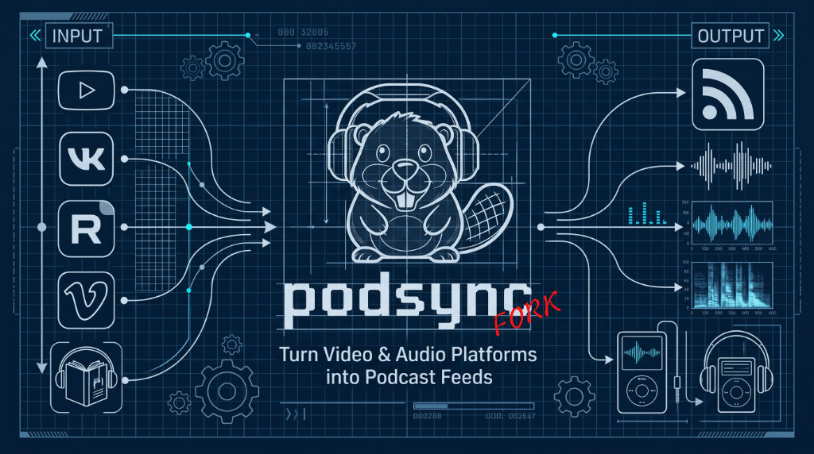

# Podsync

<p align="center"></p>
<p align="center"><a href="README.md">English</a> | <b>Русский</b></p>

[](https://github.com/tatarinovms/podsync/releases/latest)
[](https://github.com/tatarinovms/podsync/pkgs/container/podsync)
[](go.mod)
[](LICENSE)

Podsync превращает видеоканалы, плейлисты, готовые подкасты и локальные аудиокниги в RSS-ленты. Подпишитесь на них в подкаст-приложении для прослушивания офлайн, а загрузками управляйте через встроенную веб-панель.

Этот форк расширяет [mxpv/podsync](https://github.com/mxpv/podsync) персональными лентами, импортом аудиокниг, веб-панелью и интеграцией MCP.

[Возможности](#возможности) · [Быстрый старт](#быстрый-старт) · [Настройка](#настройка) · [Firefox](#расширение-firefox) · [MCP](#ai-клиенты-и-mcp) · [Документация](#документация)

## Возможности

- **Подкаст-ленты:** загрузка аудио и видео, расписания обновлений, выбор качества, фильтры эпизодов и ограничения хранения.
- **Персональные ленты:** подборки из ссылок и файлов до 4 ГиБ; переименование, копирование и перенос эпизодов.
- **Аудиокниги:** локальные папки как серийные ленты с естественной сортировкой глав, метаданными и обложками. Аудиофайлы раздаются без дублирования.
- **Веб-панель:** поиск по библиотеке, плеер, повторные загрузки, обложки и журнал Activity. Светлая и тёмная темы Catppuccin.
- **Загрузчик:** cookies, HTTP/SOCKS-прокси с логином и паролем, общие маршруты и настройки провайдеров, переопределения для лент и диагностика URL.
- **Администрирование:** REST API, инструменты MCP, переносимые бэкапы, проверки состояния и нативные обновления с проверкой целостности на поддерживаемых установках Linux/macOS.
- **Telegram-бот:** добавление ссылок в персональные ленты, просмотр состояния, повтор загрузки и уведомления об ошибках и восстановлении в личном чате. Настраивается и включается в Web Admin без правки `config.toml` и перезапуска; доступ можно ограничить одним Telegram user ID, а трафик Bot API — направить через HTTP/SOCKS5-прокси.

### Поддерживаемые источники

| Источник | Возможности и требования |
|---|---|
| YouTube | Каналы и плейлисты; для метаданных ленты нужен ключ YouTube Data API. Загрузка через yt-dlp. |
| Rutube | Каналы, плейлисты, профили и отдельные видео; ключ API не нужен. |
| VK Video | Каналы, сообщества, пользователи и плейлисты на `vkvideo.ru`, `vk.com` и `vk.ru`; нужен токен VK. |
| Vimeo | Каналы, группы и пользователи; нужен access token Vimeo. |
| SoundCloud | Плейлисты (`/user/sets/...`), через сторонний клиент. |
| RSS / Apple Podcasts | Зеркалирование подкаст-RSS или получение RSS по ссылке на шоу Apple Podcasts. |
| Локальные файлы | Папки аудиокниг и загрузки в персональные ленты. |

Скачивание зависит от ограничений источника и установленной версии yt-dlp.

## Быстрый старт

### 1. Создайте `config.toml`

В новой папке сохраните минимальный конфиг. Перед запуском замените пароль:

```toml
[server]
port = 8080
# Для доступа с других устройств задайте доступный им адрес:
# hostname = "https://podcast.example.com"

[server.admin]
enabled = true
username = "admin"
password = "CHANGE_ME"

[storage.local]
data_dir = "./data"

[database]
dir = "./db"
```

Полный [справочник конфигурации](config.toml.example) содержит примеры TLS, привязки к IP и провайдеров. Адаптируйте их перед использованием: это не минимальный конфиг для запуска.

### 2. Запустите Podsync

Выберите Docker или готовый бинарный файл.

**Docker Compose** уже включает yt-dlp и ffmpeg. Сохраните рядом с `config.toml` файл `compose.yaml`:

```yaml
services:
  podsync:
    image: ghcr.io/tatarinovms/podsync:latest
    restart: unless-stopped
    ports:
      - "8080:8080"
    volumes:
      - ./config.toml:/app/config.toml
      - ./data:/app/data
      - ./db:/app/db
```

```bash
mkdir -p data db
docker compose pull
docker compose up -d
```

**Готовый бинарный файл:** распакуйте [релиз](https://github.com/tatarinovms/podsync/releases/latest) для Linux (`x86_64` / `arm64`), macOS Apple Silicon (`arm64`) или Windows (`x86_64`). Установите yt-dlp и ffmpeg, затем запустите из папки с конфигом:

```bash
./podsync --config config.toml
```

В Windows используйте `./podsync.exe --config config.toml` в PowerShell. Go нужен только для [сборки из исходников](#разработка).

### 3. Добавьте ленту и подпишитесь

Откройте [http://localhost:8080/admin](http://localhost:8080/admin), войдите и добавьте источник. Если нужны ключи провайдера, настройте их в **Sources & downloads**. Для отдельных ссылок и файлов используйте **Personal feeds**, для локальных книг — **Audiobooks**.

Нажмите **Subscribe** и скопируйте RSS-ссылку в подкаст-приложение. Перед подпиской с другого устройства укажите доступный адрес сервера в `server.hostname`. При публикации сервиса в интернете используйте HTTPS.

## Настройка

Для повседневного управления используйте веб-панель. [config.toml.example](config.toml.example) описывает расширенные параметры и переменные окружения: расписания, очистку, нормализацию, шаблоны имён файлов, хранилище и DNS.

[Руководство по Web Admin / REST API](docs/ru/web_admin.md) описывает маршруты загрузок, логин и пароль прокси, cookies, Activity и бэкапы. [Руководство по развёртыванию](docs/ru/deployment_guide_agents.md) содержит зависимости для нативного запуска, reverse proxy, обновление и команды бэкапа/восстановления через CLI.

[Руководство по Telegram-боту](docs/ru/telegram.md) описывает настройку, привязку, команды и уведомления.

Бэкапы включают конфигурацию, состояние БД, обложки и опционально секреты. Скачанные медиафайлы не включаются. При восстановлении пути хранилища и порт целевого сервера сохраняются по умолчанию.

Для обновления Docker скачайте образ и пересоздайте контейнер:

```bash
docker compose pull
docker compose up -d
```

Публичные `/health/live` и `/health/ready` проверяют доступность процесса и готовность БД. Подробнее — в [руководстве по мониторингу](docs/ru/monitoring_uptime_kuma.md).

## Расширение Firefox

[Скачайте подписанное расширение Podsync Share (`.xpi`)](https://github.com/tatarinovms/podsync/releases/download/v2.27.0/924c9395d5e947a39fac-1.0.5.xpi), откройте его в Firefox и подтвердите установку.

В **Connection settings** укажите API URL Podsync (например, `https://podcast.example.com/api/v1`) и данные администратора, затем подтвердите запрос Firefox на доступ к этому серверу. Загрузите список персональных лент, выберите одну и отправьте вкладку YouTube, VK Video или Rutube как аудио или видео. Окно останется открытым и покажет название ленты и ID поставленного в очередь эпизода. Подробнее — в [руководстве расширения](extensions/podsync-firefox/README.md).

## AI-клиенты и MCP

В **Access & integrations → MCP** можно получить конфигурацию для **OpenCode v2**, **Hermes Agent** или **Codex**. Проверка подключения отправляет авторизованный запрос MCP `initialize` из браузера; подключение AI-клиента нужно проверить отдельно.

Podsync поддерживает stdio (`podsync --config config.toml --mcp`), прямой HTTP JSON-RPC на `/mcp` и SSE на `/mcp/sse`. Для локальных конфигураций бинарный файл и конфиг должны находиться на компьютере клиента.

OpenCode и Codex обнаруживают проектный [скилл Podsync](.agents/skills/podsync/SKILL.md). Для Hermes скопируйте папку скилла в `~/.hermes/skills/podsync/`. Скилл даёт инструкции; MCP настраивается отдельно.

Примеры, список инструментов и диагностика подключения — в [руководстве по MCP](docs/ru/mcp.md).

## Разработка

Установите Go версии из [go.mod](go.mod), yt-dlp и ffmpeg. В папке исходников выполните:

```bash
make build
./bin/podsync --config config.toml
```

Архитектура, тесты, правила UI и выпуск релизов описаны в [документации разработчика](docs/dev/README.md) и [русском указателе](docs/ru/development.md). Правила репозитория — в [AGENTS.md](AGENTS.md).

## Документация

| Тема | Руководства |
|---|---|
| Установка и управление | [Развёртывание](docs/ru/deployment_guide_agents.md) · [Web Admin / API](docs/ru/web_admin.md) · [Мониторинг](docs/ru/monitoring_uptime_kuma.md) |
| Библиотека | [Персональные ленты](docs/ru/personal-feeds.md) · [Аудиокниги](docs/ru/audiobooks.md) |
| Правила загрузки | [Фильтры эпизодов](docs/ru/filters.md) · [Расписание cron](docs/ru/cron.md) |
| Ключи провайдеров | [YouTube](docs/ru/how_to_get_youtube_api_key.md) · [VK Video](docs/ru/how_to_get_vk_token.md) · [Vimeo](docs/ru/how_to_get_vimeo_token.md) |
| Автоматизация | [MCP](docs/ru/mcp.md) · [Скилл агента](.agents/skills/podsync/SKILL.md) |
| Справочники | [Конфигурация](config.toml.example) · [Разработка](docs/dev/README.md) |

## Лицензия

[MIT](LICENSE).
