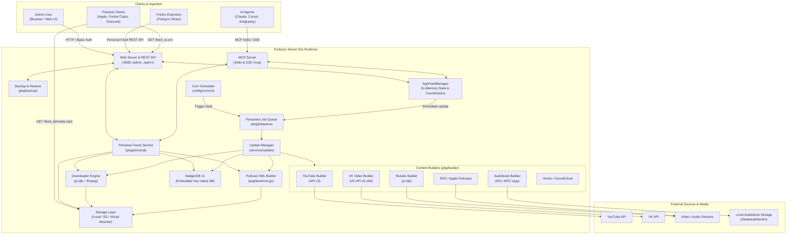
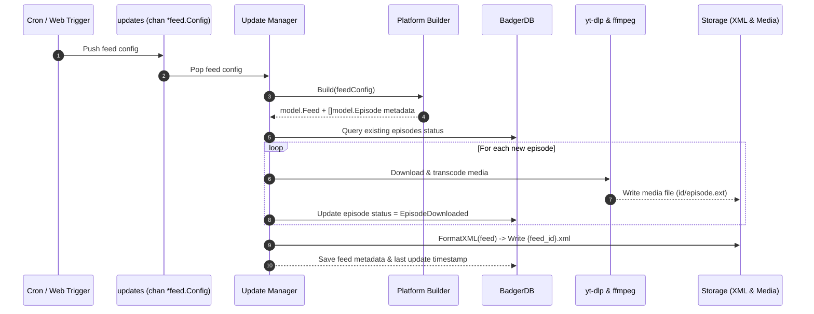

# Architecture & System Design

See the [developer documentation index](./README.md) for related guides.

This document details the architectural principles, component structure, data flow, concurrency patterns, and storage mechanisms of **Podsync**.

---

## 1. High-Level Architecture

Podsync operates as a self-hosted content pipeline that transforms external video and audio sources (YouTube, Rutube, VK Video, Vimeo, SoundCloud), existing RSS feeds, Apple Podcasts pages, personal media collections, and local audiobook directories into podcast feeds compatible with Apple Podcasts, Pocket Casts, Overcast, AntennaPod, and any RSS reader.

---

## 2. Core Components

### 2.1 AppFeedManager (`cmd/podsync/feed_manager*.go`)
The central orchestrator connecting the Web UI, MCP protocol, BadgerDB, and the Update pipeline. The type is implemented across focused files: `feed_manager.go` (lifecycle, status, shared episode helpers), `feed_manager_feeds.go`, `feed_manager_tokens.go`, `feed_manager_config.go`, `feed_manager_status.go`, `feed_manager_backup.go`, and `feed_manager_audiobooks.go`. It:
- Holds in-memory thread-safe references to all registered feed configs (`m.feeds map[string]*feed.Config`).
- Manages dynamic additions, updates, deletions, and config persistence to `config.toml`.
- Coordinates live reload: on any feed configuration update (`UpdateFeed`), it triggers `m.updates <- f` so the RSS XML is immediately regenerated.
- Implements `web.AdminManager` interface consumed by both REST API and MCP proxy.
- Loads, orders, and links episodes through one shared set of helpers so the library, detail, and paginated endpoints cannot drift apart.

### 2.2 Content Builders (`pkg/builder/`)
Platform-specific metadata parsers implementing the `builder.Builder` interface:
- **`youtube.go`**: Queries YouTube Data API v3 for channel/playlist uploads, tracks episode IDs, titles, descriptions, and durations.
- **`vkvideo.go`**: Interfaces with VK API v`5.199`, converts community handles (`@name`) to negative owner IDs (`-196446247`), excludes live streams/premieres, and formats playable links.
- **`rutube.go`**: Queries Rutube video lists via native `yt-dlp` scraping without requiring third-party API tokens.
- **`rss.go`**: Parses existing podcast RSS metadata and episodes for feed preview and mirroring.
- **`apple.go`**: Resolves `podcasts.apple.com` and `itunes.apple.com` show pages through the iTunes Lookup API, with page metadata fallback, then hands the discovered RSS URL to the regular RSS pipeline.
- **`audiobook.go`**: Local directory crawler. Automatically scans MP3/M4A/FLAC/OGG files, sorts chapters naturally, extracts album/artist/title ID3 tags, and extracts embedded APIC cover art via `ffmpeg`.

### 2.3 Downloader Engine (`pkg/ytdl/`)
- Encapsulates `yt-dlp` process execution with configurable timeout, proxy, and audio transcoding.
- Injects Netscape `cookies.txt` or `--cookies-from-browser` to bypass YouTube bot detection and 429 rate limits.
- Supports custom format selection (`bestaudio`, `bestvideo[height<=?]+bestaudio/best`).

### 2.4 Podcast XML Generator (`pkg/feed/xml.go`)
- Builds standard iTunes Podcast XML feeds and Podcast 2.0 specifications.
- **Serial Feeds**: Emits `<itunes:type>serial</itunes:type>` and `<itunes:episode>N</itunes:episode>` for audiobooks so chapters play in sequential order.
- **Private Feeds**: Checks `feed.PrivateFeed || cfg.PrivateFeed`. When true, renders `<itunes:block>yes</itunes:block>` to prevent podcast directories (Apple Podcasts Directory, Spotify, Podcast Index) from publicly indexing the feed.

### 2.5 Storage Layer & Virtual Mounter (`pkg/fs/`)
- Standard storage abstraction (`fs.Storage`) supporting local disk and AWS S3.
- **Virtual Mounter (`fs.Mounter`)**: For local audiobook feeds (`audiobook://`), mounts the source directory directly under the feed namespace without copying multi-gigabyte audio files into Podsync's data directory.

### 2.6 Personal Feeds Service (`pkg/personal/`)
Core service orchestrating manually curated, universal podcast feeds:
- **Universal Format (Audio + Video)**: Supports mixing audio tracks (MP3, OGG, OPUS, WAV, FLAC) and video tracks (MP4, MKV, WebM) within the same feed, assigning dynamic `<enclosure>` MIME types per episode.
- **Reference-Counted Media Pool**: Uploaded and downloaded files live in a shared directory (`_personal/{media_id}/`). Copying an episode to another feed creates a new membership GUID without duplicating the file on disk. Files are only deleted when the reference counter reaches zero and deletion was confirmed.
- **Ingestion Pipeline**: Ingests direct media URLs, platform links (YouTube, VK Video, Rutube), local server file paths (`file_path`), and multipart file uploads (up to 4 GiB) with automatic `ffmpeg` transcoding. Supports audio quality (`high`/`low`) and video max height (`480`, `720`, `1080`, `1440`, `2160`, `0`) controls.
- **State Isolation**: Operates inside an independent BadgerDB transactional namespace (`podsync/personal/v1/`), preventing collisions with `config.toml` channels.

### 2.7 Backup, Recovery & Native Updates (`pkg/backup/`, `pkg/selfupdate/`)
- Portable `.tar.gz` backups contain a manifest, checksums, `config.toml`, a transactionally consistent Badger stream, custom covers, and optional secrets. Downloaded episode media is intentionally excluded.
- Restore validates the manifest and checksums before replacing state. Cross-server restores preserve the target server's storage paths and port by default; secrets can be restored independently.
- Native self-update is supported on Linux and macOS. It downloads the matching GitHub Release archive, verifies it against `checksums.txt`, atomically replaces the executable, and restarts the process. Docker deployments and Windows binary replacement do not self-update.

### 2.8 Web Admin Console Delivery (`services/web/ui.go`)
- The embedded SPA (`services/web/ui/`) is loaded once at startup. Each asset receives a content-derived ETag, precompressed gzip body, correct content type, and a cache policy (immutable for fonts, revalidate for HTML/JS/CSS), so repeat page loads cost a `304` instead of a full download.
- Static requests for missing paths with an extension return `404`; extensionless routes fall back to `index.html` for client-side navigation.
- The root `html/` mirror is kept byte-for-byte identical and verified by `TestAdminUIAssetMirror`.

### 2.9 Firefox Extension (`extensions/podsync-firefox/`)
- A zero-build WebExtension sends only supported YouTube, VK Video, and Rutube pages to a selected Personal Feed.
- The popup stores the Podsync API URL and administrator credentials in Firefox extension-local storage, lets the user choose audio/video quality, and shows maximum resolution only for video.
- The extension uses the same authenticated REST API as the Web Admin Console; it is an optional client and introduces no separate backend protocol.

---

## 3. Data Flow & Concurrency

### 3.1 Feed Synchronization Sequence

### 3.2 Concurrency Safeguards
- **Persistent Job Queue**: `pkg/jobqueue` deduplicates active work, persists state across crashes, uses claim tokens to reject stale workers, applies retry backoff, and recovers abandoned running jobs through its watchdog. A buffered channel remains only as a fallback when the persistent queue is not attached.
- **Personal Feed Jobs**: Personal work is represented as `personal://<feed_id>` and intentionally lives outside `AppFeedManager`'s regular feed map. Every claimed job must finish with `MarkDone`, `MarkFailed`, or `YieldJob`; treating it as a deleted regular feed leaves a stale active job and blocks later submissions.
- **Thread-Safe Maps**: `AppFeedManager` guards `feeds`, `cronEntries`, and `tokens` with a `sync.RWMutex`.
- **Database Concurrency**: BadgerDB handles concurrent readers and atomic write batches.

---

## 4. Database Schema (BadgerDB v1)

Podsync uses embedded BadgerDB keys with structured binary/JSON prefixes:
- `feed/{feed_id}`: Serialized `model.Feed` (metadata, title, description, author, cover URL, provider).
- `episode/{feed_id}/{episode_id}`: Serialized `model.Episode` (status, size, duration, file path, download timestamp, error state).
- `stats/{feed_id}`: Aggregated episode counts and downloaded media size.
- `job/{job_id}` and `job_active/{job_id}`: Persistent jobs and active-job index.
- Server state uses the keys supplied by callers; the database version is stored at `podsync/version`.

Status values:
- `EpisodeNew` (`new`): Discovered but not yet downloaded.
- `EpisodeDownloaded` (`downloaded`): Stored on disk and served via RSS enclosure.
- `EpisodeError` (`error`): Failed to download (network, rate limit, ffmpeg error).
- `EpisodeCleaned` (`cleaned`): Pruned by retention policy (`keep_last`).

### 4.1 Personal Feeds Namespace (`podsync/personal/v1/`)
Personal feeds maintain transactional records segregated from standard feeds:
- `feed/{feed_id}`: Serialized `personal.Feed` (title, description, cover art URL, sort order, private flag, episode count).
- `episode/{feed_id}/{episode_id}`: Serialized `personal.Membership` (episode GUID, pointer to shared `media_id`, added timestamp).
- `media/{media_id}`: Serialized `personal.Media` (source URL/path, stored path, format, quality, max_height, duration, size, status, error, reference count).
- `initialized`: Flag marking initial database seeding (`My Feed` / `personal`).
- `deleted/{feed_id}` / `delete_pending`: Tombstones for async background cleanup.
